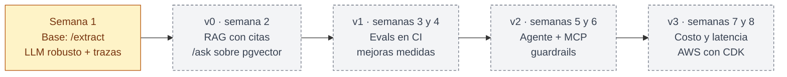

# 01 · Visión y alcance

> **Estado:** detallado · **Lectura:** 5 min · [Índice](README.md) · Siguiente: [02 · Dominio CFDI](02-dominio-cfdi.md)

## El problema

Quien emite o recibe facturas en México convive con dos fricciones:

1. **Dudas de llenado.** ¿Qué uso de CFDI corresponde a este gasto? ¿Cuándo va PUE y cuándo PPD?
   ¿Qué régimen fiscal del receptor es válido? Las respuestas existen, pero están repartidas en
   documentos largos del SAT (el Anexo 20, la guía de llenado y los catálogos).
2. **Captura y revisión.** Las facturas llegan como texto, PDF o XML y alguien tiene que pasarlas a
   datos estructurados y revisar que cuadren (RFC bien formado, totales consistentes).

Un LLM ayuda en las dos, pero un LLM también inventa. Por eso el requisito central de cfdi-copilot
no es "que conteste", sino **que cada respuesta se pueda verificar**: con una cita a un documento
oficial o con una validación que pasa o falla.

## Qué hace

| # | Como… | quiero… | para… | Se resuelve con | Llega en |
|---|---|---|---|---|---|
| 1 | sistema de cuentas por pagar | mandar el texto de una factura y recibir sus datos validados | no capturar a mano ni guardar datos que no cuadran | `POST /extract` | semana 1 |
| 2 | persona que factura o desarrolla facturación | preguntar algo de CFDI 4.0 y recibir la respuesta con su fuente | confiar en la respuesta sin leer el documento completo | `POST /ask` | v0 · semana 2 |
| 3 | responsable del proyecto | saber con números si un cambio mejoró o empeoró la calidad | no degradar el sistema sin darme cuenta | evals en CI | v1 · semanas 3 y 4 |
| 4 | analista | pedir tareas compuestas ("valida esta factura y dime si el uso de CFDI es correcto") | resolverlo en una sola petición | `POST /agent` + servidor MCP | v2 · semanas 5 y 6 |
| 5 | quien opera el servicio | conocer el costo por pregunta y la latencia p95 | operar sin sorpresas | caché, ruteo de modelos, despliegue en AWS | v3 · semanas 7 y 8 |

## Qué no hace

Estos límites son deliberados y simplifican todo lo demás:

- **No timbra ni cancela.** No se conecta a ningún PAC ni a los servicios web del SAT.
- **No usa datos reales.** Solo documentos públicos del SAT y facturas sintéticas, con RFC genéricos
  o inventados que no pertenecen a nadie.
- **No valida contra el padrón del SAT.** Revisa formato y consistencia interna de una factura; no
  puede saber si un RFC existe ni si el nombre coincide con el registrado.
- **No sustituye a un contador.** Responde con lo que dicen los documentos indexados y lo dice
  cuando no encuentra evidencia.

## Principios de diseño

1. **Verificable antes que elocuente.** Citas obligatorias, validación de reglas y permiso explícito
   de responder "no lo sé".
2. **El LLM es un componente no confiable.** Su salida se trata igual que la de un cliente externo:
   se valida antes de usarla o guardarla.
3. **Todo se mide.** Calidad, latencia y costo son números, y el CI falla si la calidad baja.
4. **Simple primero.** Un solo Postgres guarda facturas, vectores, texto y eventos hasta que una
   medición justifique otra pieza.
5. **Datos sintéticos y públicos.** El repositorio es público y debe poder serlo siempre.

## Ruta de versiones

| Versión | Qué se agrega | Cómo se demuestra que funciona |
|---|---|---|
| Semana 1 | `/extract` con structured outputs, reintentos y timeouts; trazas en Langfuse; tablas de facturas; primer servidor MCP | porcentaje de extracciones válidas al primer intento, latencia p50 y p95 |
| v0 | Ingesta de 2 o 3 documentos del SAT, búsqueda híbrida, `/ask` con citas y abstención, golden set | recall@5 sobre el golden set |
| v1 | Evals de retrieval y de generación en CI con umbral; reranker, reescritura de consultas y filtros solo si los números mejoran | tabla de antes y después: recall, faithfulness, p95, costo por pregunta |
| v2 | Agente con LangGraph, tools por MCP, aprobación humana, enmascarado de datos personales, permisos por RFC | suite de 20 ataques en CI; evals de trayectorias del agente |
| v3 | Streaming, caché, ruteo de modelos, límites por usuario; despliegue con CDK | costo por 1,000 preguntas y costo real de un día en AWS |

## Qué significa "bueno"

| Atributo | Cómo se mide | Dónde se trabaja |
|---|---|---|
| Extracción correcta | % válido al primer intento · % con total exacto | semana 1 |
| Recuperación | recall@5 y MRR sobre el golden set | semanas 2 a 4 |
| Fidelidad (no inventar) | faithfulness · % de respuestas con cita válida · abstenciones correctas | semanas 2 y 3 |
| Latencia | p50 y p95 por endpoint | semanas 1, 4 y 7 |
| Costo | costo por pregunta y por 1,000 preguntas | semanas 4, 7 y 8 |
| Seguridad | ataques bloqueados de la suite · fugas de datos personales | semana 6 |

Las metas numéricas se fijan cuando exista una línea base medida (semana 3). Antes de medir, cualquier
objetivo sería inventado.

## Comprueba que lo entendiste

1. ¿Por qué el requisito central es "verificable" y no "que conteste bien"?

Porque un LLM puede redactar una respuesta convincente y falsa. Si cada respuesta trae una cita o
pasa por una validación, un humano o un test puede comprobarla sin confiar en el modelo.

2. ¿Qué tipo de error <em>no</em> puede detectar el sistema por diseño?

Los que requieren datos fuera del sistema: que un RFC exista en el padrón del SAT, que el nombre
corresponda a ese RFC o que una factura esté realmente timbrada. Solo se revisa formato y
consistencia interna.

3. ¿Por qué no hay metas numéricas de calidad desde el día uno?

Porque todavía no hay línea base. Las metas se fijan sobre números medidos con el golden set; una
meta puesta antes de medir no dice nada sobre el sistema real.

