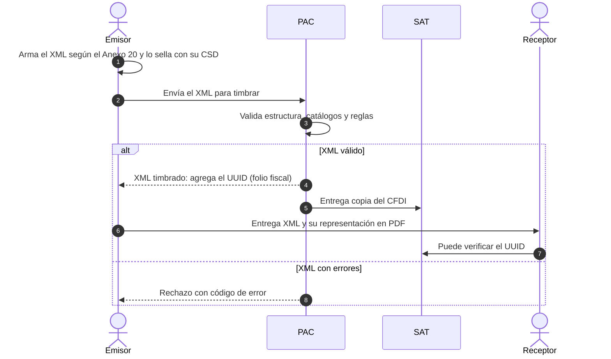
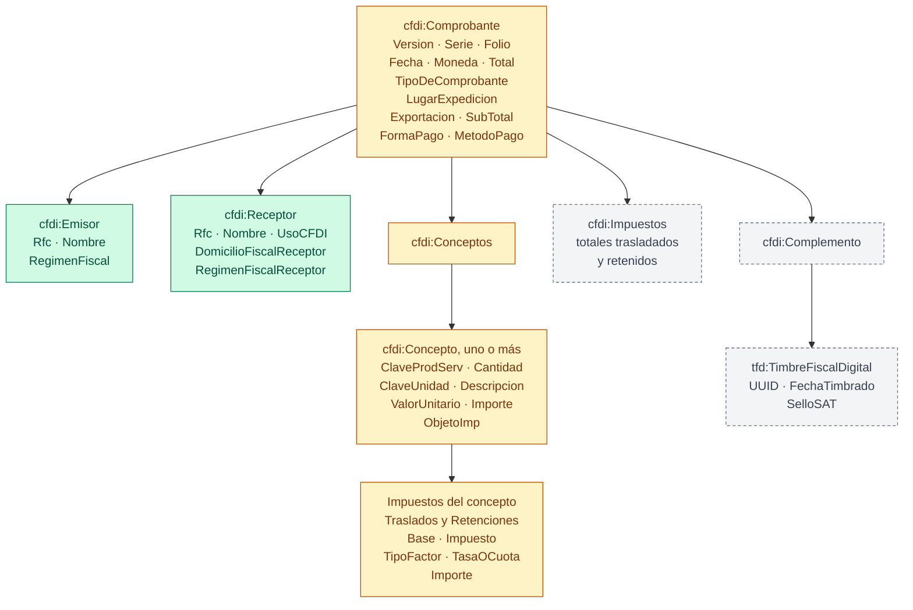
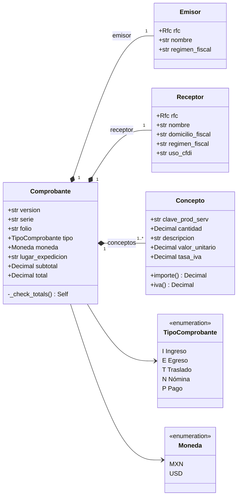

# 02 · Dominio: el CFDI 4.0 que modelamos

> **Estado:** detallado (coincide con `src/cfdi_copilot/models.py`) · **Lectura:** 10 min ·
> [Índice](README.md) · Anterior: [01 · Visión](01-vision-y-alcance.md) · Siguiente: [03 · Arquitectura](03-arquitectura.md)

## CFDI en cinco minutos

Un **CFDI** (Comprobante Fiscal Digital por Internet) es la factura electrónica mexicana: un XML
con estructura fija, sellado por quien lo emite y certificado ("timbrado") por un tercero
autorizado. La versión vigente es la **4.0** y su estructura la define el **Anexo 20** del SAT.



- **Emisor**: quien factura. **Receptor**: a quien se le factura. Ambos se identifican por su **RFC**.
- **PAC** (Proveedor Autorizado de Certificación): empresa autorizada por el SAT que valida y timbra.
- **CSD** (Certificado de Sello Digital): la llave con la que el emisor firma el XML.
- **UUID** o folio fiscal: el identificador único que el PAC asigna al timbrar.

**cfdi-copilot vive fuera de ese ciclo.** No sella, no timbra y no consulta al SAT. Trabaja con dos
cosas: los documentos públicos que explican las reglas y facturas sintéticas que imitan la estructura.

## Anatomía de un comprobante



Verde: modelado con sus atributos principales · amarillo: modelado en parte o simplificado ·
gris: no modelado (ver [simplificaciones](#simplificaciones-conscientes)).

## Qué campos modelamos hoy

El código usa nombres de Python y acepta los del Anexo 20 como alias, así que el JSON que entra y
sale del sistema se ve igual que el XML oficial.

| Nodo | Atributo del Anexo 20 | Campo en Python | Regla que se valida | Ejemplo |
|---|---|---|---|---|
| Comprobante | `Version` | `version` | exactamente `4.0` | `4.0` |
| | `Serie` | `serie` | opcional, hasta 25 caracteres | `SYN` |
| | `Folio` | `folio` | opcional, hasta 40 caracteres | `10` |
| | `TipoDeComprobante` | `tipo` | `I`, `E`, `T`, `N` o `P` | `I` |
| | `Moneda` | `moneda` | `MXN` o `USD`; por omisión `MXN` | `MXN` |
| | `LugarExpedicion` | `lugar_expedicion` | código postal de 5 dígitos | `28013` |
| | `SubTotal` | `subtotal` | decimal ≥ 0; igual a la suma de importes | `76168.04` |
| | `Total` | `total` | decimal ≥ 0; igual a subtotal más IVA | `88354.93` |
| Emisor | `Rfc` | `rfc` | formato de RFC; se normaliza a mayúsculas | `MMH850117RC8` |
| | `Nombre` | `nombre` | 1 a 254 caracteres | `EMPRESA SINTETICA SA DE CV` |
| | `RegimenFiscal` | `regimen_fiscal` | 3 dígitos | `601` |
| Receptor | `Rfc` | `rfc` | formato de RFC | `TJKD910714KYQ` |
| | `Nombre` | `nombre` | 1 a 254 caracteres | `PERSONA FICTICIA` |
| | `DomicilioFiscalReceptor` | `domicilio_fiscal` | código postal de 5 dígitos | `90897` |
| | `RegimenFiscalReceptor` | `regimen_fiscal` | 3 dígitos | `612` |
| | `UsoCFDI` | `uso_cfdi` | 3 o 4 caracteres alfanuméricos | `G03` |
| Concepto | `ClaveProdServ` | `clave_prod_serv` | 8 dígitos | `44121600` |
| | `Cantidad` | `cantidad` | decimal > 0 | `4` |
| | `Descripcion` | `descripcion` | 1 a 1000 caracteres | `Papelería de oficina` |
| | `ValorUnitario` | `valor_unitario` | decimal ≥ 0 | `19042.01` |
| | `TasaIVA` (no existe en el Anexo 20) | `tasa_iva` | entre 0 y 0.16; por omisión 0.16 | `0.16` |
| | (calculado) | `importe` | cantidad × valor unitario, a centavos | `76168.04` |
| | (calculado) | `iva` | importe × tasa, a centavos | `12186.89` |

Los RFC del ejemplo son cadenas aleatorias con formato válido; no pertenecen a nadie.

## Reglas de negocio

Son las invariantes que el modelo garantiza. Si un objeto `Comprobante` existe, las cumple.

1. **RFC con formato válido.** Tres letras (persona moral) o cuatro (persona física), seis dígitos de
   fecha y tres caracteres de homoclave: `^[A-ZÑ&]{3,4}\d{6}[A-Z0-9]{3}$`. Antes de validar se quitan
   espacios y se pasa a mayúsculas.
2. **Importe de cada concepto** = `Cantidad × ValorUnitario`, redondeado a centavos.
3. **IVA de cada concepto** = `importe × TasaIVA`, redondeado a centavos.
4. **SubTotal** = suma de los importes.
5. **Total** = SubTotal + suma del IVA.
6. **Inmutable y estricto.** Una factura emitida no cambia (`frozen=True`) y un campo desconocido es
   un error, no algo que se ignora (`extra="forbid"`).

Ejemplo con la factura sintética de la tabla:

```
importe  = 4 × 19042.01            = 76168.04
iva      = 76168.04 × 0.16         = 12186.8864  →  12186.89
SubTotal = 76168.04
Total    = 76168.04 + 12186.89     = 88354.93
```

Todo el dinero es `Decimal`. Con `float`, `0.1 + 0.2` da `0.30000000000000004`, y una diferencia de
un centavo basta para que una factura no cuadre.

Dos detalles de cómo valida Pydantic que importan más adelante:

- Las reglas 4 y 5 viven en un validador de modelo (`_check_totals`) que **solo corre si todos los
  campos pasaron** su validación individual. Si el RFC es inválido y además el total no cuadra, el
  error reportado es solo el del RFC. Por eso una reparación puede necesitar más de una vuelta.
- El redondeo es el que trae `Decimal` por omisión (mitad al par).

## Entidades



`Comprobante` es la **raíz del agregado**: nadie crea ni guarda un `Concepto` suelto. Esa idea
regresa en el [modelo de datos](07-modelo-de-datos.md), donde una factura con sus conceptos se
guarda en una sola transacción.

## Catálogos del SAT que más aparecen

Muchos campos no son texto libre: su valor tiene que existir en un catálogo publicado por el SAT.

| Catálogo | Para qué | Ejemplos |
|---|---|---|
| `c_TipoDeComprobante` | Qué clase de comprobante es | `I` Ingreso · `E` Egreso · `T` Traslado · `N` Nómina · `P` Pago |
| `c_RegimenFiscal` | Régimen del emisor y del receptor | `601` General de Ley Personas Morales · `612` Personas Físicas con Actividades Empresariales y Profesionales · `626` Régimen Simplificado de Confianza |
| `c_UsoCFDI` | Para qué usará el receptor la factura | `G01` Adquisición de mercancías · `G03` Gastos en general · `S01` Sin efectos fiscales |
| `c_FormaPago` | Cómo se pagó | `01` Efectivo · `03` Transferencia electrónica · `04` Tarjeta de crédito · `99` Por definir |
| `c_MetodoPago` | En cuántas exhibiciones | `PUE` una sola exhibición · `PPD` parcialidades o diferido |
| `c_ClaveProdServ` | Qué se vendió (8 dígitos) | `01010101` No existe en el catálogo |
| `c_ClaveUnidad` | Unidad de medida | `H87` Pieza · `E48` Unidad de servicio |
| `c_Impuesto` | Qué impuesto | `001` ISR · `002` IVA · `003` IEPS |
| `c_ObjetoImp` | Si el concepto causa impuesto | `01` No objeto · `02` Sí objeto |

Hoy el código valida el **formato** de estas claves, no que existan: un régimen `999` pasa. La
validación contra catálogos reales llega con el primer servidor MCP (ver
[06](06-agente-mcp-y-seguridad.md)).

## Simplificaciones conscientes

El modelo actual es un subconjunto. Cada recorte es deliberado y tiene fecha de revisión.

| Simplificación de hoy | Cómo es en el estándar | Cuándo se revisa |
|---|---|---|
| `TasaIVA` como atributo del concepto | Cada concepto lleva un nodo de impuestos con traslados (`Base`, `Impuesto=002`, `TipoFactor=Tasa`, `TasaOCuota=0.160000`, `Importe`) y el comprobante repite los totales | al generar XML sintético (semana 2) |
| Faltan `Fecha`, `FormaPago`, `MetodoPago`, `Exportacion`, `ObjetoImp`, `ClaveUnidad`, `Descuento` | Obligatorios o condicionales según el tipo de comprobante | cuando un flujo los necesite: XML sintético (semana 2) y la tool de validar CFDI (semana 5) |
| Totales con igualdad exacta al centavo | El estándar define tolerancias de redondeo | si el XML sintético lo exige |
| RFC validado solo por formato | El último carácter es un dígito verificador y el RFC debe existir en el padrón | dígito verificador: semana 2 · padrón: fuera de alcance |
| Claves de catálogo validadas solo por formato | Deben existir en el catálogo vigente | primer servidor MCP (semana 1) |
| Sin timbre ni UUID | El complemento `TimbreFiscalDigital` lo agrega el PAC | nunca: el sistema no timbra |
| Solo IVA trasladado | También hay retenciones, IEPS y conceptos exentos | solo si un caso de prueba lo pide |
| `importe` e `iva` salen en minúsculas en el JSON | En el XML el atributo es `Importe` | al definir el contrato final de `/extract` |

## De dónde sale la verdad del dominio

| Documento | Qué define | Uso en el proyecto |
|---|---|---|
| Anexo 20 | La estructura del XML y sus validaciones | Corpus del RAG; referencia para `models.py` |
| Guía de llenado del CFDI 4.0 | Cómo llenar cada campo, con casos | Corpus del RAG; fuente de las preguntas del golden set |
| Catálogos del CFDI | Los valores válidos de cada clave | Servidor MCP de catálogos |

Los tres son públicos. Se descargan con un script y no se guardan en el repositorio
(ver [05 · Flujos de RAG](05-flujos-rag.md)).

## Comprueba que lo entendiste

<details>
<summary>1. ¿Por qué el total es <code>Decimal</code> y no <code>float</code>?</summary>

Porque `float` no representa exactamente la mayoría de los decimales. Los errores de redondeo se
acumulan y una diferencia de un centavo rompe la regla `Total = SubTotal + IVA`. `Decimal` hace
aritmética exacta en base 10.
</details>

<details>
<summary>2. El LLM devuelve un RFC mal formado y un total que no cuadra. ¿Cuántos errores reporta Pydantic?</summary>

Uno: el del RFC. La regla de totales es un validador de modelo que solo corre cuando todos los
campos pasaron su validación individual. Al corregir el RFC aparecerá el segundo error.
</details>

<details>
<summary>3. ¿Qué diferencia hay entre validar el formato de un RFC y validar que sea verdadero?</summary>

El formato se comprueba con una expresión regular, sin salir del programa. Que sea verdadero
significa que existe en el padrón del SAT y que corresponde al nombre de la factura, y eso requiere
una fuente externa a la que este sistema no se conecta.
</details>
