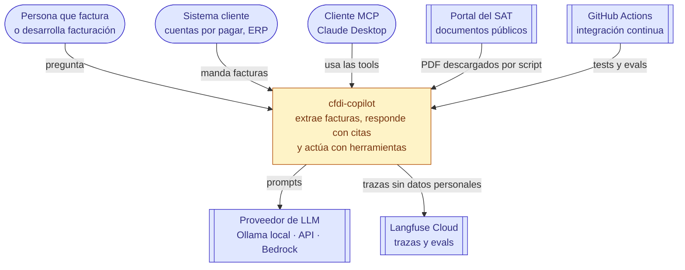
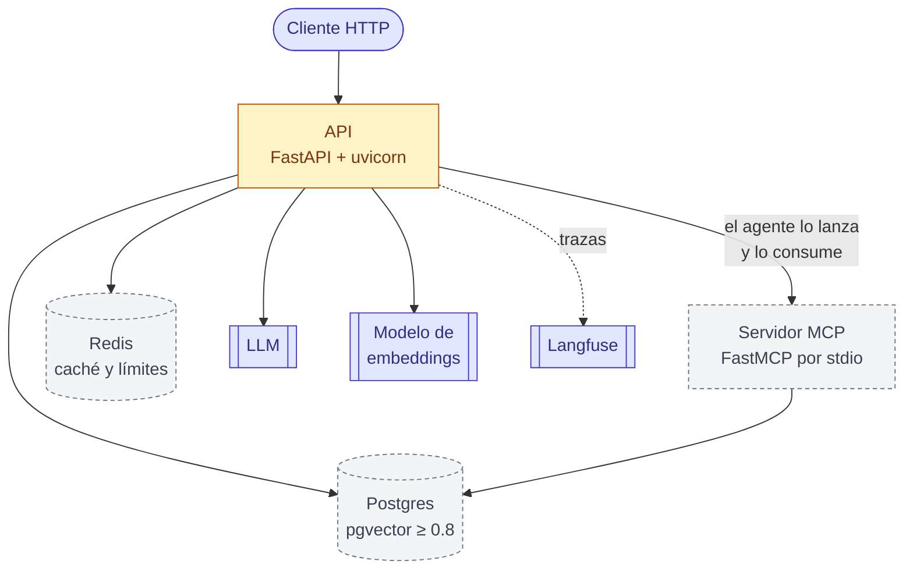
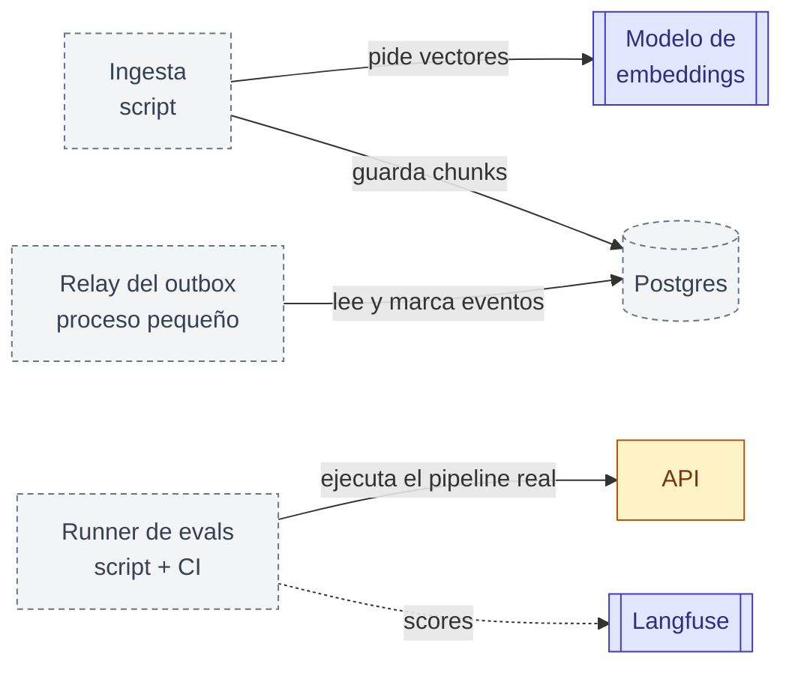
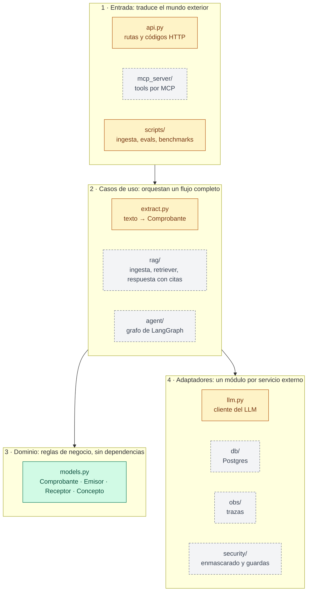

# 03 · Arquitectura

> **Estado:** detallado para lo que existe; los módulos futuros son preliminares · **Lectura:** 10 min ·
> [Índice](README.md) · Anterior: [02 · Dominio](02-dominio-cfdi.md) · Siguiente: [04 · Flujo de /extract](04-flujo-extract.md)

Tres niveles de zoom: quién usa el sistema, qué procesos corren y cómo se reparte el código.

## Nivel 1 · Contexto

Quién le habla a cfdi-copilot y de qué servicios externos depende.

Lo que este nivel deja claro:

- El sistema **no depende del SAT en tiempo de ejecución**. Los documentos se descargan una vez, por
  script, y se indexan.
- El **LLM es externo y reemplazable**: Ollama para desarrollar sin costo, un modelo por API para
  evals y producción, Bedrock como proveedor alterno en la semana 8.
- Todo lo que sale hacia un tercero (prompts y trazas) pasa por el mismo punto, y ahí es donde se
  enmascaran datos personales en la semana 6.

## Nivel 2 · Contenedores

Qué procesos y almacenes existen cuando el sistema está completo.

**Los que atienden peticiones.** La API es el centro: todo lo demás lo usa ella.

**Los que corren por lote.** No atienden a nadie: se ejecutan a mano, por horario o en el CI.

| Contenedor | Tecnología | Responsabilidad | Llega en |
|---|---|---|---|
| API | FastAPI + uvicorn | Único punto de entrada HTTP: `/extract`, `/ask`, `/agent` | semana 1 |
| Postgres | Postgres con pgvector ≥ 0.8 | Facturas, chunks con vectores y texto, eventos del outbox | semana 1 (facturas) · semana 2 (RAG) |
| Servidor MCP | FastMCP, transporte stdio | Expone las tools con un contrato estándar para el agente y para Claude Desktop | semana 1 (versión mínima) · semana 5 |
| Ingesta | Script de línea de comandos | Descarga, parte, calcula embeddings y guarda los documentos del SAT | semana 2 |
| Runner de evals | Script + GitHub Actions | Corre el golden set contra el pipeline y falla el CI si baja la calidad | semana 3 |
| Relay del outbox | Proceso pequeño | Publica los eventos pendientes de la tabla `outbox_events` | semana 1 (patrón) |
| Redis | Redis | Caché de respuestas, rate limit y presupuesto de tokens | semana 7 |
| LLM, embeddings, Langfuse | Servicios externos | Generación, vectores, trazas | semanas 1 y 2 |

Un solo Postgres hace de base transaccional, de base vectorial y de buscador de texto. Es una
decisión, no un accidente; el porqué está en [10 · Decisiones](10-decisiones.md).

## Nivel 3 · Módulos del paquete

El código se organiza en cuatro capas. La regla es que **las flechas solo apuntan hacia abajo**.

Los nombres en gris (`rag/`, `agent/`, `db/`, `obs/`, `security/`, `mcp_server/`) son tentativos.

### Qué hace cada pieza que ya existe

| Pieza | Archivo | Responsabilidad en una frase | Recibe → entrega | Colabora con |
|---|---|---|---|---|
| `ExtractRequest` | `api.py` | Contrato de entrada de `/extract`; limita el tamaño del texto | JSON → objeto validado | FastAPI |
| `create_app()` y `lifespan` | `api.py` | Arma la aplicación y administra los recursos compartidos (crea y cierra el cliente del LLM) | cliente opcional → `FastAPI` | `OllamaClient` |
| Ruta `POST /extract` | `api.py` | Traduce HTTP a caso de uso y errores a códigos (422, 502, 504) | petición → respuesta | `extract_comprobante()` |
| `extract_comprobante()` | `extract.py` | El caso de uso: arma el prompt, llama al LLM y valida el resultado | cliente + texto → `(Comprobante, ChatResult)` | `OllamaClient`, `Comprobante` |
| `ExtractionError` | `extract.py` | Dice "el LLM contestó, pero no sirve"; lleva los errores y la salida cruda | — | la ruta lo convierte en 422 |
| `OllamaClient` | `llm.py` | Único lugar que habla HTTP con el LLM: pool de conexiones, timeouts, medición | mensajes → `ChatResult` | httpx |
| `ChatMessage` / `ChatResult` | `llm.py` | Mensaje de entrada; resultado con contenido, tokens y latencia | — | — |
| `Comprobante` y sus partes | `models.py` | Las reglas del dominio: formatos, totales, inmutabilidad | JSON → objeto que cumple las reglas | nadie: no importa nada del resto |
| `fake_comprobante()` / `render_text()` | `synthetic.py` | Datos de prueba deterministas: una factura por semilla y su versión en texto | semilla → dict / texto | tests y benchmarks |

### Reglas de dependencia

1. **El dominio no conoce la infraestructura.** `models.py` no importa FastAPI, httpx ni la base de
   datos. Se puede probar con puro Python.
2. **Los casos de uso reciben sus dependencias.** `extract_comprobante(llm, text)` recibe el cliente
   en lugar de crearlo. Por eso los tests pueden pasarle un cliente falso (`httpx.MockTransport`) y
   correr sin red.
3. **Un adaptador por servicio externo.** Solo `llm.py` sabe cómo es la API de Ollama. Si cambia el
   proveedor, cambia un archivo.
4. **Abstraer cuando llegue el segundo caso.** Hoy hay un proveedor y una clase (`OllamaClient`).
   Cuando exista el segundo (el juez de la semana 3 o el ruteo de la semana 7) se extrae una interfaz
   (`Protocol`) con varias implementaciones. Antes sería complejidad sin uso.

## Entornos

| Entorno | Dónde corre | LLM | Base de datos | Para qué |
|---|---|---|---|---|
| Desarrollo | laptop | Ollama local, costo cero | Postgres local | programar y depurar |
| Tests | laptop y GitHub Actions | ninguno: se simula con `httpx.MockTransport` | ninguna o Postgres de servicio | rapidez y determinismo |
| Evals | GitHub Actions | modelo económico por API | Postgres de servicio | medir calidad con umbral |
| Producción efímera | AWS: ECS Fargate + RDS | API; Bedrock como alterno | RDS con pgvector | medir costo real y destruir el mismo día |

Regla del proyecto: **Ollama solo se usa para desarrollar**. No sirve como juez de evals ni para
reportar métricas, porque un modelo local chico no representa lo que correría en producción.

## Endpoints

| Ruta | Entrada | Salida | Errores propios | Llega en |
|---|---|---|---|---|
| `POST /extract` | `{"text": "..."}` | `Comprobante` | 422 entrada o extracción inválida · 502 LLM caído · 504 timeout | semana 1 |
| `POST /ask` | `{"question": "..."}` más filtros opcionales | respuesta, lista de citas y bandera de abstención | 422 · 502 · 504 | semana 2 |
| `POST /agent` | mensaje e identificador de conversación | pasos del agente y respuesta final, en streaming desde la semana 7 | 422 · 429 límites · 502 · 504 | semana 5 |
| `GET /health` | — | estado del servicio | — | por agregar antes del despliegue |

El contrato detallado de `/extract`, con ejemplos reales, está en el [documento 04](04-flujo-extract.md).

## Configuración y secretos

- La configuración entra por **variables de entorno**. Hoy son dos: `OLLAMA_BASE_URL` y `OLLAMA_MODEL`.
- `.env.example` documenta las variables; el `.env` real nunca se sube al repositorio.
- Las llaves de API y la URL de la base llegan en las semanas 1 a 3. En AWS viven en Secrets Manager.

## Comprueba que lo entendiste

1. ¿Por qué <code>extract_comprobante()</code> recibe el cliente del LLM como parámetro?

Para poder sustituirlo. En producción recibe el cliente real que vive en la aplicación; en los
tests recibe uno con transporte simulado. El caso de uso no cambia y se prueba sin red.

2. Si mañana se cambia Ollama por otro proveedor, ¿qué archivos cambian?

Idealmente solo `llm.py`, el adaptador. El caso de uso (`extract.py`) y la ruta (`api.py`) dependen
de `chat()` y de `ChatResult`, no de cómo es la API de Ollama.

3. ¿Por qué el cliente HTTP se crea en el <code>lifespan</code> y no dentro de la ruta?

Porque mantiene un pool de conexiones. Crearlo una vez al arrancar y cerrarlo al apagar reutiliza
conexiones entre peticiones; crearlo en cada petición paga el costo de conexión cada vez y deja
recursos abiertos si algo falla.

