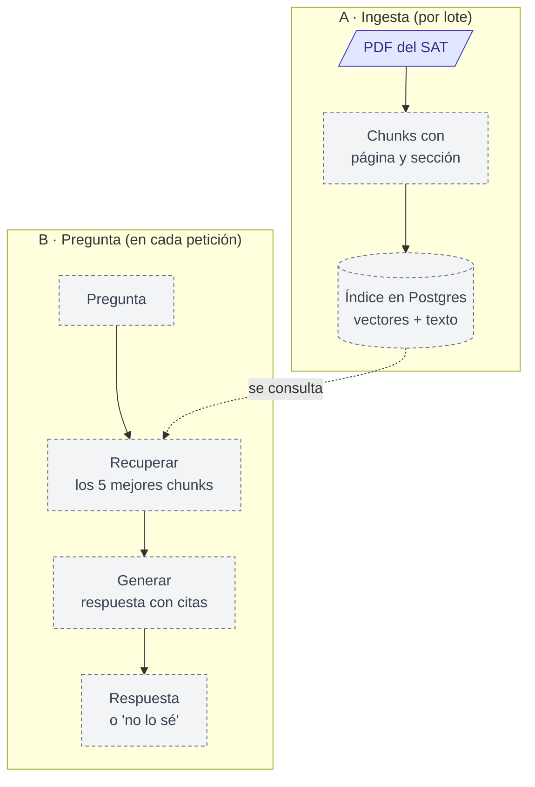
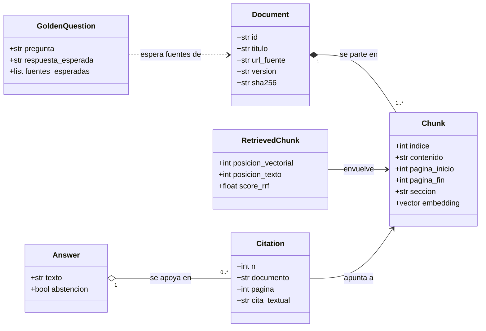
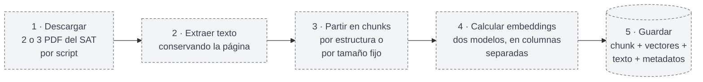
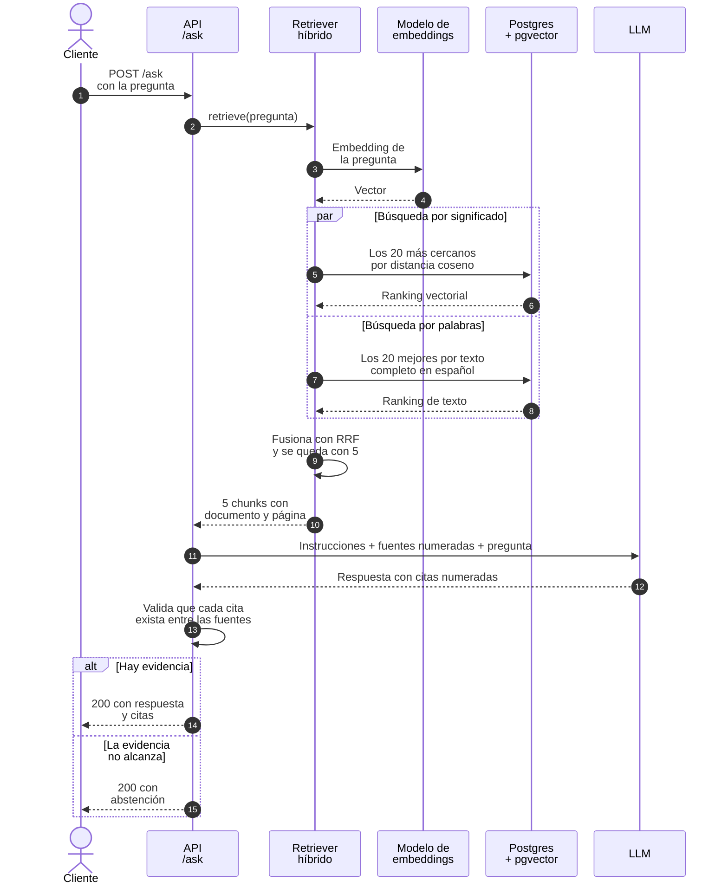
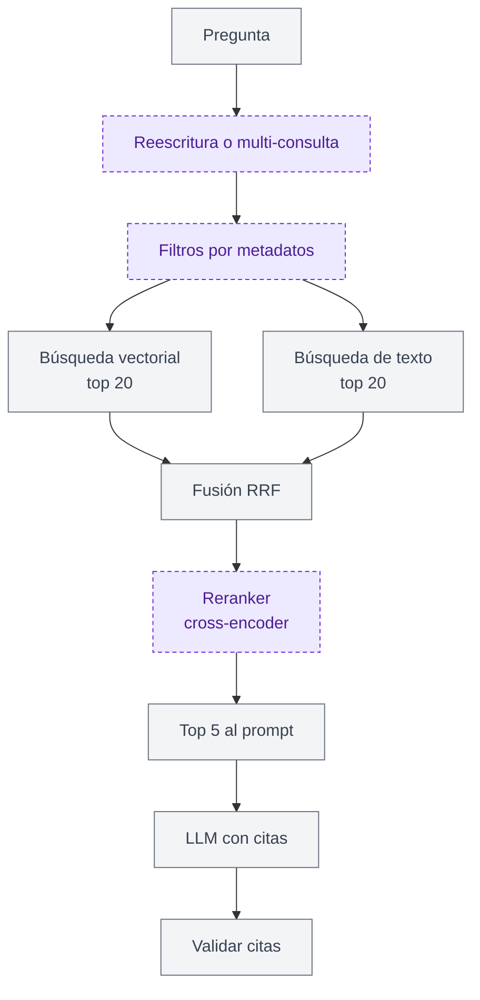

# 05 · Flujos de RAG: indexar documentos y responder con citas

> **Estado:** preliminar · se cierra con números en las semanas 2 a 4 · **Lectura:** 15 min ·
> [Índice](README.md) · Anterior: [04 · Flujo de /extract](04-flujo-extract.md) · Siguiente: [06 · Agente, MCP y seguridad](06-agente-mcp-y-seguridad.md)

## La idea

Un LLM contesta "de memoria": puede estar desactualizado y, cuando no sabe, inventa. **RAG**
(generación aumentada con recuperación) cambia el orden: primero se **buscan** los fragmentos
relevantes de los documentos oficiales y después se le pide al LLM que responda **solo con ellos**,
citando de dónde salió cada afirmación.

Son dos flujos independientes que se encuentran en el índice:



Casi todos los problemas de calidad de un RAG se deciden en el flujo A. Si el fragmento correcto no
quedó bien partido o bien indexado, el flujo B no tiene de dónde responder.

## Entidades



| Entidad | Qué es | Dónde vive |
|---|---|---|
| `Document` | Un documento oficial con su origen, versión y huella (`sha256`) | tabla `documents` |
| `Chunk` | Un fragmento del documento, con su página y su sección, listo para buscarse | tabla `chunks` |
| `RetrievedChunk` | Un chunk que salió en una búsqueda, con su posición en cada ranking | memoria, por petición |
| `Citation` | La referencia numerada que acompaña a una afirmación de la respuesta | respuesta de `/ask` |
| `Answer` | El texto final, sus citas y la bandera de abstención | respuesta de `/ask` |
| `GoldenQuestion` | Una pregunta de prueba con la respuesta y las fuentes que se esperan | archivo JSONL en el repo |

## Flujo A · Ingesta



| Paso | Decisión de diseño | Por qué |
|---|---|---|
| 1 · Descargar | Los PDF no se guardan en el repo. Se registra URL, fecha de descarga, versión, vigencia y `sha256` | Una cita solo es confiable si se sabe exactamente qué documento y qué versión se indexó |
| 2 · Extraer | Se conserva el número de página de cada bloque de texto | La cita necesita la página. Los PDF del SAT tienen muchas tablas, así que el extractor importa |
| 3 · Partir | Se comparan dos estrategias: por estructura (una sección o un atributo por chunk) y por tamaño fijo con traslape | Por estructura da chunks con sentido completo; por tamaño fijo es simple y parejo. Gana la que dé mejor recall |
| 4 · Embeddings | `bge-m3` (1024 dimensiones) y `text-embedding-3-small` (1536), cada uno en su columna | Dimensiones distintas no caben en la misma columna; así se comparan con las mismas preguntas |
| 5 · Guardar | Operación idempotente: volver a correr la ingesta no duplica chunks | La ingesta se va a repetir muchas veces mientras se afina |

Una primera versión imperfecta es suficiente. Lo que importa es poder medirla y mejorarla.

## Flujo B · Pregunta



Los valores 20 y 5 son puntos de partida; se ajustan midiendo.

### Por qué búsqueda híbrida

Cada tipo de búsqueda falla donde la otra acierta.

| Pregunta | Búsqueda vectorial (significado) | Búsqueda de texto (palabras) |
|---|---|---|
| "¿Qué pongo en uso de CFDI si es un gasto normal del negocio?" | Bien: entiende la paráfrasis | Regular: las palabras no coinciden con las del documento |
| "¿Qué significa la clave G03?" | Regular: un código corto casi no tiene significado | Bien: encuentra el texto exacto `G03` |
| "¿Cuándo se usa PPD?" | Regular | Bien |

En documentos fiscales abundan claves y siglas (`G03`, `PPD`, `c_UsoCFDI`), así que perder la
búsqueda exacta sale caro.

La búsqueda de texto usa una configuración en español que ignora acentos, para que "facturación" y
"facturacion" sean la misma palabra.

### Cómo se fusionan dos rankings: RRF

Los puntajes de las dos búsquedas no son comparables (una distancia y una relevancia de texto).
**RRF** (*Reciprocal Rank Fusion*) ignora los puntajes y usa solo las **posiciones**:

```
score(chunk) = suma, por cada ranking donde aparece, de  1 / (60 + posición)
```

| Chunk | Posición vectorial | Posición en texto | Cálculo | Score |
|---|---|---|---|---|
| A | 1 | 3 | 1/61 + 1/63 | 0.0323 |
| C | 5 | 1 | 1/65 + 1/61 | 0.0318 |
| B | 2 | no aparece | 1/62 | 0.0161 |

B era el segundo mejor por significado, pero A y C aparecen en **las dos** listas y le ganan. Esa es
la intuición: coincidir en ambos rankings vale más que destacar en uno. El 60 es la constante usual
y evita que el primer lugar domine demasiado.

### Respuesta con citas y abstención

El prompt tiene tres partes fijas:

```text
[Instrucciones]
Responde solo con la información de las fuentes numeradas.
Cada afirmación lleva la cita de su fuente, así: [1].
Si las fuentes no alcanzan para responder, di exactamente: "No lo sé con los documentos que tengo."

[Fuentes]
[1] <título del documento>, página <n>: <texto del chunk>
[2] <título del documento>, página <n>: <texto del chunk>
...

[Pregunta]
<la pregunta del usuario>
```

Después de generar, el código **no confía** en la respuesta y revisa:

1. Que cada número citado exista entre las fuentes que se mandaron.
2. Que una respuesta sin ninguna cita sea una abstención y no una afirmación sin respaldo.
3. Que la salida tenga la forma esperada.

| Campo de la respuesta | Tipo | Contenido |
|---|---|---|
| `answer` | texto | La respuesta con sus marcas `[n]` |
| `citations` | lista | Por cada cita: número, documento, página y fragmento citado |
| `abstained` | booleano | `true` cuando la respuesta es "no lo sé" |

Abstenerse es un resultado correcto, no un fallo: una respuesta "no lo sé" a una pregunta que los
documentos no cubren cuenta a favor.

## Mejoras de la v1

En la semana 4 se prueban tres mejoras. Cada una entra al pipeline solo si los números lo justifican.



Gris: el pipeline base de la v0 · morado punteado: mejoras opcionales de la v1.

| Mejora | Qué promete | Qué cuesta | Cómo se decide |
|---|---|---|---|
| **Reranker** | Reordena los 20 candidatos con un modelo que lee pregunta y chunk juntos; sube la precisión del top 5 | Latencia extra por pregunta, y dinero si es por API | recall@5 y MRR contra p95 |
| **Reescritura de la consulta** | Mejora preguntas vagas o mal escritas generando una o varias versiones | Una llamada extra al LLM por pregunta | recall@5 contra costo por pregunta |
| **Filtros por metadatos** | Busca solo en el documento o la vigencia correctos | Con un índice aproximado, filtrar puede dejar menos resultados de los pedidos | recall con filtro contra recall sin filtro |

Sobre los filtros: con un índice aproximado (HNSW), Postgres primero toma un número fijo de vecinos
del índice (40 por omisión) y **después** aplica el filtro. Si el filtro solo deja pasar al 10 % de
las filas, de esos 40 quedan unos 4, aunque se hayan pedido 5. Desde pgvector 0.8 se puede activar
el **escaneo iterativo**, que sigue recorriendo el índice hasta juntar los resultados pedidos o
llegar a un tope.

## Qué se mide

| Qué | Métrica | Cuándo |
|---|---|---|
| ¿Se recuperó la fuente correcta? | recall@5 y MRR | semana 2 |
| ¿La respuesta se apoya en las fuentes? | faithfulness | semana 3 |
| ¿Las citas son válidas? | % de respuestas con todas las citas existentes | semana 2 |
| ¿Se abstiene cuando debe? | abstenciones correctas sobre preguntas sin respuesta en el corpus | semana 3 |
| ¿Cuánto tarda y cuánto cuesta? | p95 y costo por pregunta | semana 4 |

Las definiciones están en [08 · Evals y observabilidad](08-evals-y-observabilidad.md).

## Decisiones abiertas

Se cierran en la semana 2, con el golden set, no por intuición:

- Extractor de PDF.
- Estrategia y tamaño de chunk.
- Modelo de embeddings ganador.
- Cuántos candidatos trae cada búsqueda y cuántos chunks llegan al prompt.
- Modelo generador.

## Comprueba que lo entendiste

<details>
<summary>1. La respuesta es incorrecta. ¿Cómo sabes si el problema es de recuperación o de generación?</summary>

Se revisa si la fuente esperada estaba entre los chunks recuperados. Si no estaba, el problema es de
recuperación (chunking, embeddings, búsqueda). Si estaba y aun así la respuesta salió mal, es de
generación (prompt, modelo, validación de citas).
</details>

<details>
<summary>2. ¿Por qué RRF usa posiciones y no los puntajes de cada búsqueda?</summary>

Porque los puntajes no están en la misma escala: uno es una distancia entre vectores y el otro una
relevancia de texto. Las posiciones sí son comparables y no requieren calibrar nada.
</details>

<details>
<summary>3. ¿Por qué la pregunta y los chunks deben usar el mismo modelo de embeddings?</summary>

Porque cada modelo define su propio espacio vectorial. La distancia entre un vector de un modelo y
uno de otro no significa nada, aunque tuvieran las mismas dimensiones.
</details>
