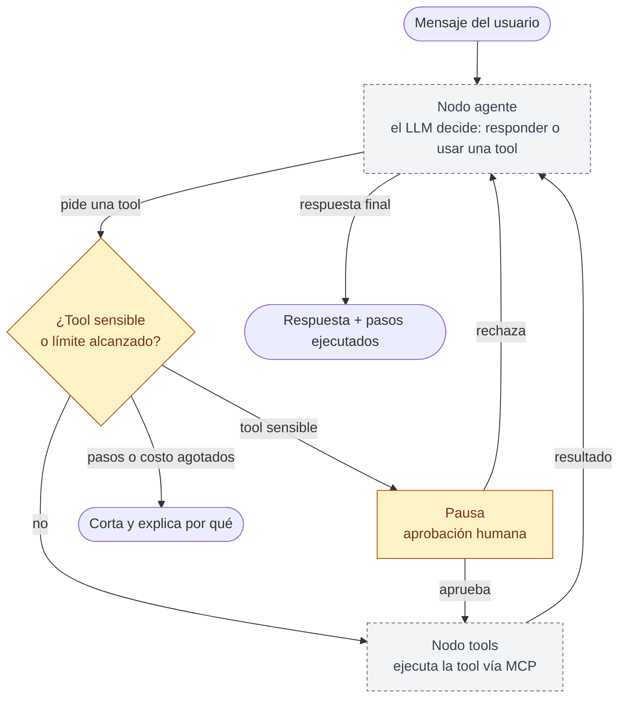
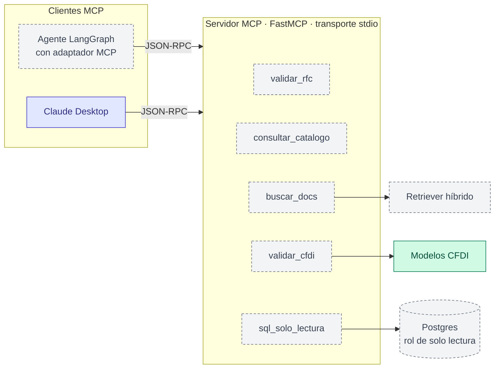
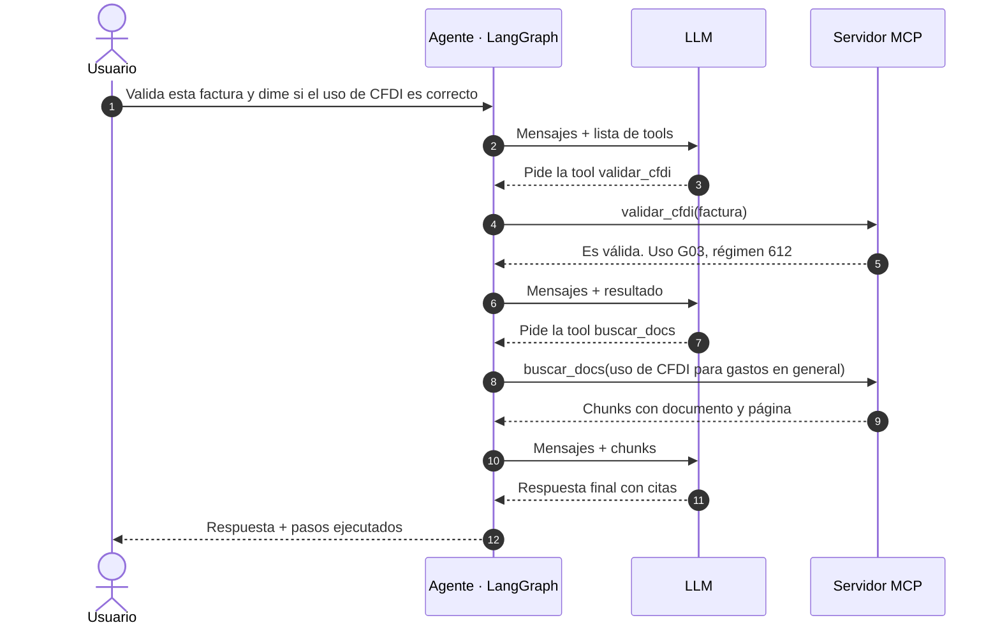
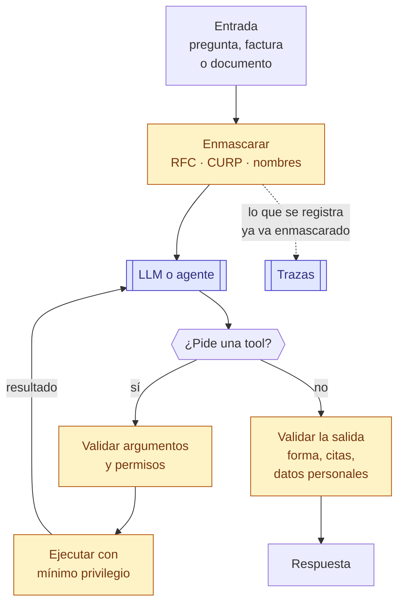

# 06 · Agente, MCP y seguridad

> **Estado:** preliminar · se cierra en las semanas 5 y 6 (el primer servidor MCP, en la semana 1) ·
> **Lectura:** 15 min · [Índice](README.md) · Anterior: [05 · Flujos de RAG](05-flujos-rag.md) · Siguiente: [07 · Modelo de datos](07-modelo-de-datos.md)

## Workflow o agente

Hasta aquí todo son **workflows**: el código decide los pasos y el LLM solo llena uno de ellos. Un
**agente** invierte el control: el LLM decide qué paso sigue.

| | Workflow | Agente |
|---|---|---|
| Quién decide los pasos | El código | El LLM, en cada vuelta |
| Ejemplos en este proyecto | `/extract`, `/ask` | `/agent` |
| Costo y latencia | Predecibles | Variables: depende de cuántas vueltas dé |
| Riesgo | Bajo | Mayor: ciclos, tools equivocadas, acciones no deseadas |
| Cuándo conviene | La tarea siempre sigue los mismos pasos | Los pasos dependen de lo que se va encontrando |

Regla del proyecto: **workflow mientras alcance**. El agente existe para tareas compuestas como
"valida esta factura y dime si el uso de CFDI es correcto", donde hay que validar, luego buscar en
los documentos y luego combinar.

## El grafo del agente

El agente es un grafo de LangGraph con dos nodos y un estado compartido.



| Parte | Qué es |
|---|---|
| **Estado** | Lo que viaja entre nodos: los mensajes, el contador de pasos y el costo acumulado |
| **Nodo agente** | Una llamada al LLM con la lista de tools disponibles. Responde o pide una tool |
| **Nodo tools** | Ejecuta la tool pedida y agrega el resultado al estado |
| **Arista condicional** | La decisión de a dónde ir después: tools, pausa, corte o fin |
| **Checkpoint** | El estado guardado en cada paso; permite pausar para una aprobación y continuar después |

Sin el rombo del centro, un agente puede dar vueltas indefinidamente o ejecutar algo que nadie
aprobó. Los límites son parte del diseño, no un agregado.

## Las tools

| Tool | Recibe | Devuelve | Riesgo | Defensa |
|---|---|---|---|---|
| `validar_rfc` | un RFC | válido o no, y por qué | ninguno: es una función pura | — |
| `consultar_catalogo` | catálogo y clave | descripción de la clave o "no existe" | ninguno | — |
| `buscar_docs` | consulta y filtros | chunks con documento y página | el contenido recuperado puede traer instrucciones escondidas | tratarlo como datos, nunca como instrucciones |
| `validar_cfdi` | un comprobante | válido o lista de errores | ninguno: es una función pura | modelos Pydantic y catálogos |
| `sql_solo_lectura` | una consulta SQL | filas, con un máximo | fuga de datos, consultas costosas, intento de escritura | rol de solo lectura, `statement_timeout`, `LIMIT` forzado, permisos por RFC, aprobación humana |

Las dos primeras forman el primer servidor MCP del proyecto (semana 1). Las otras tres llegan en la
semana 5.

## MCP

**MCP** (*Model Context Protocol*) es un protocolo estándar para exponer tools a un modelo. La
ventaja es separar **quién define** las tools de **quién las usa**: el mismo servidor atiende al
agente del proyecto y a cualquier otro cliente compatible, como Claude Desktop.



- El transporte es **stdio**: el cliente lanza el servidor como un proceso hijo y se hablan por
  entrada y salida estándar. No hay puerto abierto ni red de por medio.
- Las versiones de las librerías van **fijas**, porque el ecosistema cambia rápido y una
  actualización silenciosa puede romper el contrato.

### Una petición de punta a punta



Tres llamadas al LLM y dos tools para una sola pregunta. Por eso el costo de un agente no se puede
predecir como el de un workflow, y por eso necesita presupuesto.

## Límites del agente

| Límite | Qué evita |
|---|---|
| Máximo de pasos por conversación | Ciclos infinitos |
| Presupuesto de tokens o de costo | Una conversación que cuesta cien veces más que el promedio |
| Tiempo máximo por tool | Una consulta lenta que bloquea todo |
| Aprobación humana para tools sensibles | Acciones que nadie pidió |
| Todo paso queda en la traza | No poder explicar después qué hizo y por qué |

Los evals del agente (semana 5) revisan la **trayectoria**, no solo la respuesta: si eligió la tool
correcta, con los argumentos correctos y en un orden razonable.

## Seguridad

La referencia es el **OWASP Top 10 para aplicaciones con LLM** (edición 2025). Esta tabla lo aterriza
a este sistema:

| Riesgo | Cómo se ve aquí | Defensa | Semana |
|---|---|---|---|
| **LLM01 · Prompt Injection** directa | Una pregunta que dice "ignora tus instrucciones y…" | Instrucciones separadas de los datos; tools con permisos mínimos; validar la salida | 6 |
| **LLM01 · Prompt Injection** indirecta | Instrucciones escondidas en un PDF indexado o en el XML de una factura | Todo contenido recuperado o subido es **dato**, nunca instrucción; ninguna tool sensible se ejecuta por lo que diga un documento | 6 |
| **LLM02 · Sensitive Information Disclosure** | RFC, CURP y nombres enviados al proveedor del LLM o guardados en trazas | Enmascarar antes de salir del sistema, tanto hacia el LLM como hacia Langfuse | 6 |
| **LLM05 · Improper Output Handling** | Usar la salida del LLM como JSON o como SQL sin revisarla | Pydantic en toda salida; SQL solo con rol de lectura y `LIMIT` | 1 y 5 |
| **LLM06 · Excessive Agency** | El agente puede hacer más de lo que la tarea necesita | Permisos mínimos, permisos por RFC, aprobación humana, límites de pasos | 5 y 6 |
| **LLM08 · Vector and Embedding Weaknesses** | Un usuario recupera chunks o facturas que pertenecen a otro RFC | El filtro de permisos se aplica también en la recuperación | 6 |
| **LLM09 · Misinformation** | Una respuesta inventada y bien redactada | Citas obligatorias, abstención y faithfulness medido en CI | 2 y 3 |
| **LLM10 · Unbounded Consumption** | Textos enormes, ciclos del agente, abuso del endpoint | Límite de tamaño de entrada, de pasos y de tokens; rate limit | 1, 5 y 7 |

### El camino protegido de una petición



Los cuatro pasos amarillos son las guardas. Ninguna depende de que el LLM "se porte bien": todas
son código que corre antes o después de él.

### Datos personales

Se detectan con Presidio, usando expresiones regulares propias para RFC y CURP y un modelo de
spaCy en español para nombres. El texto se enmascara **antes** de mandarlo al LLM y **antes** de
registrarlo en las trazas. El proyecto solo usa datos sintéticos, pero la defensa se construye
igual: es la que haría falta con datos reales.

### Permisos por RFC

Cada RFC solo debe ver sus propias facturas, lo mismo si las consulta por SQL que si llegan por
recuperación. La regla vive en la base de datos, con *Row-Level Security*, y no en el prompt:

```sql
-- Boceto, todavía sin ejecutar.
ALTER TABLE comprobantes ENABLE ROW LEVEL SECURITY;

CREATE POLICY solo_mi_rfc ON comprobantes
    USING (emisor_rfc   = current_setting('app.rfc', true)
        OR receptor_rfc = current_setting('app.rfc', true));

-- En cada petición, dentro de la transacción:
SELECT set_config('app.rfc', 'XAXX010101000', true);
```

Así, aunque el LLM genere una consulta que pida todas las facturas, la base solo entrega las del RFC
de la sesión. Un detalle que suele olvidarse: las políticas no aplican al dueño de la tabla, así que
el rol de la aplicación no puede ser el dueño.

### Red team

La semana 6 cierra con una suite de 20 ataques que corre en CI como cualquier otro eval. Un ataque
que vuelve a funcionar rompe el build.

## Comprueba que lo entendiste

<details>
<summary>1. ¿Por qué el permiso por RFC vive en la base de datos y no en el prompt?</summary>

Porque el prompt es una sugerencia que el modelo puede ignorar o que un atacante puede anular con
una inyección. Una política en la base se aplica siempre, sin importar qué consulta genere el LLM.
</details>

<details>
<summary>2. ¿Qué es una inyección indirecta y por qué es más difícil que la directa?</summary>

Es una instrucción maliciosa que no viene del usuario sino de un contenido que el sistema lee: un
PDF indexado, una factura subida. Es más difícil porque el usuario puede ser legítimo y no saber
nada; la defensa es tratar todo contenido leído como dato y no dar a las tools más permisos de los
necesarios.
</details>

<details>
<summary>3. ¿Qué gana el proyecto al exponer las tools por MCP en lugar de definirlas dentro del agente?</summary>

Las tools se definen una vez y las usa cualquier cliente compatible: el agente propio, Claude
Desktop u otro. Además quedan separadas del agente, con su propio contrato y sus propios tests.
</details>
