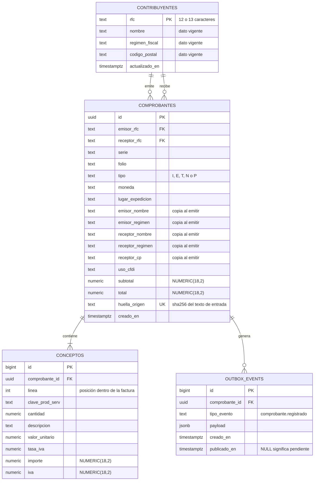
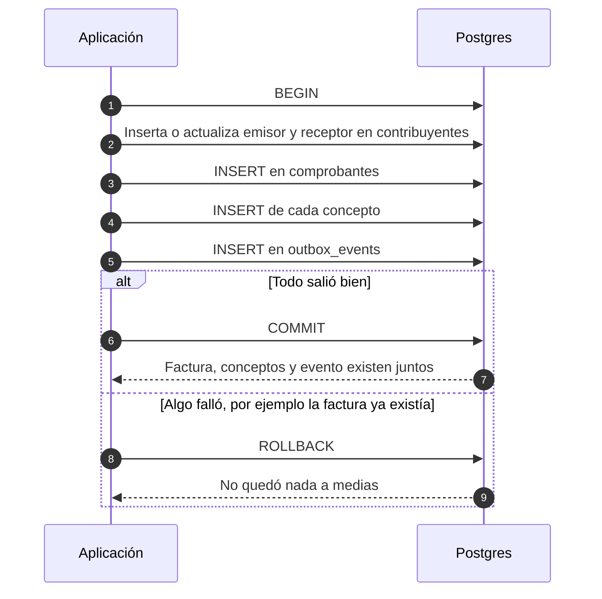
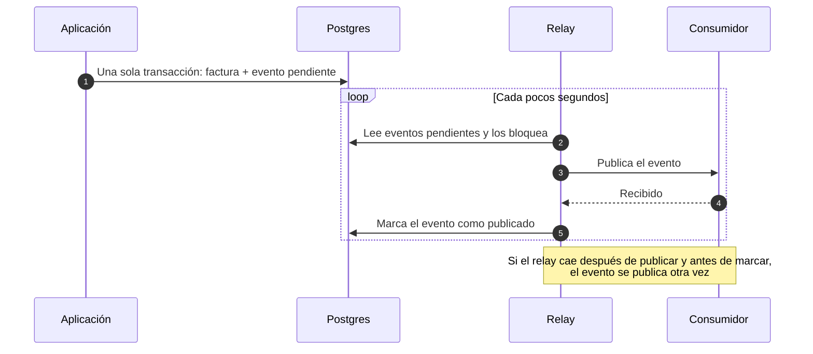
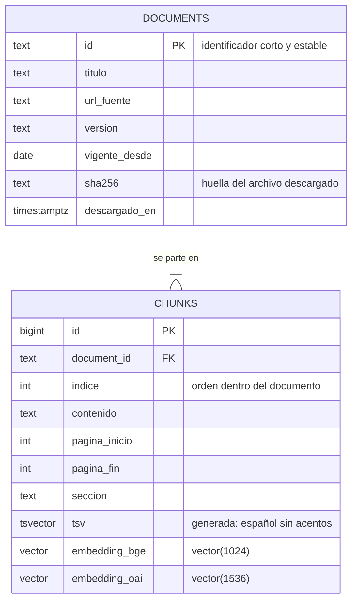

# 07 · Modelo de datos

> **Estado:** preliminar · las tablas de facturas se cierran en la semana 1 y las de RAG en la semana 2 ·
> **Lectura:** 10 min · [Índice](README.md) · Anterior: [06 · Agente, MCP y seguridad](06-agente-mcp-y-seguridad.md) · Siguiente: [08 · Evals y observabilidad](08-evals-y-observabilidad.md)

Todo vive en **un solo Postgres**: facturas, documentos indexados y eventos. El SQL de este
documento es un boceto para discutir el diseño; todavía no se ha ejecutado.

## Facturas



### Decisiones de modelado

**Normalización.** Los conceptos van en su propia tabla y no como un arreglo dentro del comprobante
(primera forma normal). Los datos del contribuyente viven una sola vez en `contribuyentes`, con el
RFC como llave.

**Una desnormalización a propósito.** El comprobante guarda una copia del nombre, el régimen y el
código postal *tal como venían en la factura*. Parece redundancia y no lo es: son dos hechos
distintos.

| Dato | Dónde | Qué representa | ¿Cambia? |
|---|---|---|---|
| `contribuyentes.nombre` | tabla maestra | Cómo se llama hoy ese RFC | Sí |
| `comprobantes.emisor_nombre` | la factura | Cómo se llamaba cuando se emitió esa factura | Nunca |

Si un contribuyente cambia de régimen, sus facturas anteriores deben seguir diciendo lo que decían.
Una factura emitida es un documento histórico.

**Dinero.** Siempre `NUMERIC`, nunca `float`, por la misma razón que el código usa `Decimal`.

**Identidad.** En un CFDI real la identidad es el UUID del timbre. Aquí no hay timbre, así que la
llave para no duplicar es `huella_origen`: el `sha256` del texto que se mandó a extraer, con
restricción de unicidad. El mismo texto siempre produce la misma huella.

**Restricciones en la base, no solo en el código.** Llaves foráneas, `NOT NULL`, montos mayores o
iguales a cero y la unicidad de la huella. Pydantic valida antes de insertar, pero la base es la
última línea de defensa y la única que ve dos peticiones simultáneas.

### Una factura se guarda en una transacción



| Propiedad | Qué significa aquí |
|---|---|
| **Atomicidad** | Los cuatro pasos de escritura ocurren todos o ninguno. Nunca hay una factura sin conceptos ni un evento sin factura |
| **Consistencia** | Al terminar se cumplen todas las restricciones: llaves foráneas, montos no negativos, huella única |
| **Aislamiento** | Si dos peticiones intentan guardar la misma factura a la vez, la restricción de unicidad hace fallar a una; la aplicación lo trata como "ya existía" |
| **Durabilidad** | Cuando `COMMIT` regresa, la factura sobrevive a una caída del servidor |

El caso de "la factura ya existía" es lo que vuelve **idempotente** al guardado: repetir la misma
petición no crea un duplicado. Esto cierra el pendiente que dejó el flujo de reintentos en el
[documento 04](04-flujo-extract.md).

### El patrón outbox

El problema: al guardar una factura hay que avisarle a otros sistemas, y "escribir en la base" y
"publicar un mensaje" son dos operaciones en dos sistemas distintos. Si la segunda falla, queda una
factura de la que nadie se enteró; si se invierte el orden, se anuncia una factura que no existe.

La solución es que el aviso sea **una fila más en la misma transacción**, y que un proceso aparte lo
publique después.



La garantía es **al menos una vez**: un evento puede repetirse, nunca perderse. Por eso quien lo
consume tiene que ser idempotente, por ejemplo recordando los identificadores de evento que ya
procesó. Si hay más de un relay, cada uno toma filas distintas con `FOR UPDATE SKIP LOCKED`.

## RAG



Tres ideas sostienen estas dos tablas:

1. **Un chunk siempre sabe de dónde viene.** Documento, página y sección viajan con él; sin eso no
   hay cita posible.
2. **Dos columnas de embeddings.** Cada modelo tiene su dimensión y su índice. Cuando la comparación
   termine, la columna perdedora se elimina.
3. **El texto se busca en español y sin acentos.** La columna `tsv` se genera sola a partir de
   `contenido`.

```sql
-- Boceto, todavía sin ejecutar.
CREATE EXTENSION IF NOT EXISTS vector;
CREATE EXTENSION IF NOT EXISTS unaccent;

-- Configuración de búsqueda: quita acentos y luego aplica las reglas del español.
CREATE TEXT SEARCH CONFIGURATION es_sin_acentos (COPY = spanish);
ALTER TEXT SEARCH CONFIGURATION es_sin_acentos
    ALTER MAPPING FOR hword, hword_part, word WITH unaccent, spanish_stem;

-- Dentro de CREATE TABLE chunks:
--   tsv tsvector GENERATED ALWAYS AS (to_tsvector('es_sin_acentos', contenido)) STORED

CREATE INDEX ON chunks USING gin (tsv);
CREATE INDEX ON chunks USING hnsw (embedding_bge vector_cosine_ops);
CREATE INDEX ON chunks USING hnsw (embedding_oai vector_cosine_ops);
```

Por qué una configuración propia en lugar de llamar a `unaccent()` dentro de la columna generada:
Postgres exige que una columna generada use funciones inmutables, y `unaccent()` no lo es. Meter el
diccionario en la configuración de búsqueda resuelve lo mismo sin ese problema.

## Lo que no va en la base

| Dato | Dónde vive | Por qué |
|---|---|---|
| Golden set de preguntas | Archivo JSONL en el repositorio | Se versiona y se revisa junto con el código |
| Trazas y scores | Langfuse | Es su trabajo; no hay que reinventarlo |
| PDF descargados | Disco local, fuera del repositorio | Se regeneran con el script de descarga |
| Caché y contadores de límites | Redis | Son datos efímeros con expiración |

## Permisos

En la semana 6 las facturas reciben *Row-Level Security* por RFC, para que cada contribuyente vea
solo las suyas. El boceto está en el [documento 06](06-agente-mcp-y-seguridad.md#permisos-por-rfc).

## Comprueba que lo entendiste

<details>
<summary>1. ¿Por qué el comprobante guarda una copia del nombre del emisor si ya existe en <code>contribuyentes</code>?</summary>

Porque son hechos distintos. La tabla maestra dice cómo se llama hoy; la factura dice cómo se
llamaba cuando se emitió, y ese dato no puede cambiar aunque el contribuyente actualice su nombre.
</details>

<details>
<summary>2. ¿Qué pasaría sin transacción si el proceso muere después de insertar el comprobante y antes de sus conceptos?</summary>

Quedaría una factura sin conceptos, con un total que no corresponde a nada. Con la transacción, esa
escritura a medias se deshace sola: o está todo, o no está nada.
</details>

<details>
<summary>3. El outbox garantiza "al menos una vez". ¿Qué le exige eso al consumidor?</summary>

Que sea idempotente. Un mismo evento puede llegarle dos veces, así que procesarlo de nuevo no debe
duplicar efectos; lo usual es recordar los identificadores de evento ya procesados.
</details>
