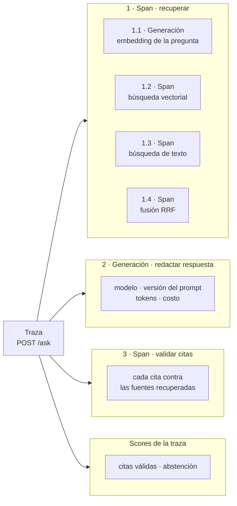
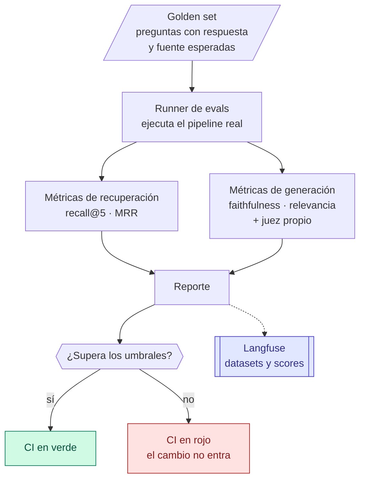
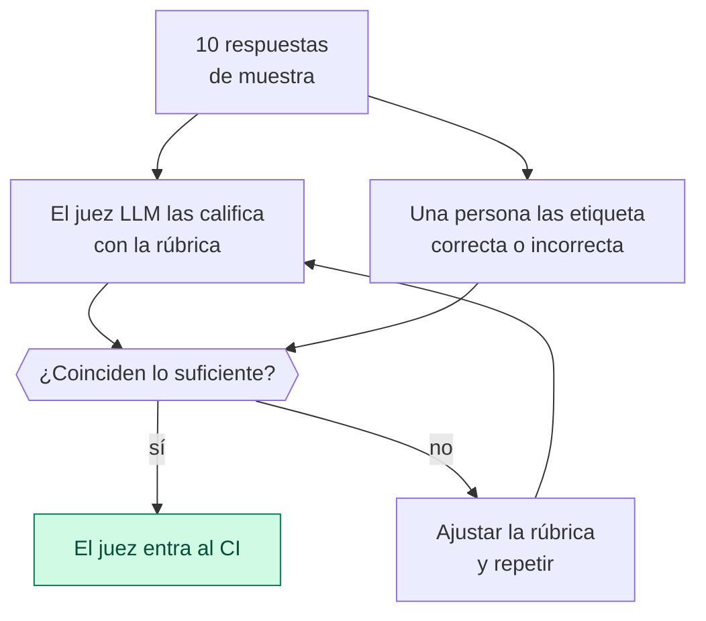
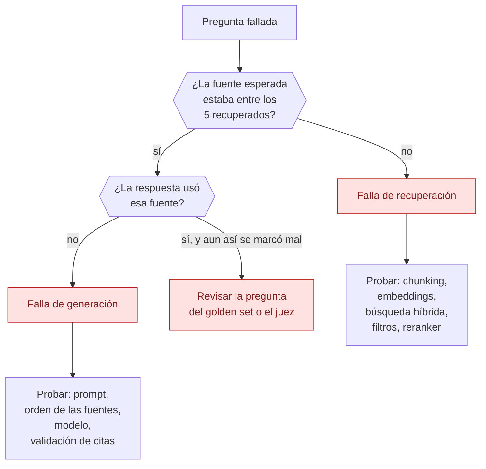

# 08 · Evals y observabilidad

> **Estado:** preliminar · las trazas se conectan en la semana 1 y los evals en la semana 3 ·
> **Lectura:** 10 min · [Índice](README.md) · Anterior: [07 · Modelo de datos](07-modelo-de-datos.md) · Siguiente: [09 · Producción y AWS](09-produccion-y-aws.md)

## Dos preguntas distintas

| | Observabilidad | Evals |
|---|---|---|
| Pregunta que responde | ¿Qué pasó en **esta** petición? | ¿Qué tan bueno es el sistema **en general**? |
| Cuándo corre | En cada petición real | Antes de aceptar un cambio |
| Con qué datos | Los que mande el usuario | Un conjunto fijo de casos con respuesta conocida |
| Herramienta | Trazas en Langfuse | Golden set + runner + CI |
| Sirve para | Depurar, medir latencia y costo | Evitar que la calidad baje sin que nadie lo note |

Se complementan: una traza rara de producción se convierte en un caso nuevo del golden set.

## Observabilidad

### Vocabulario

| Término | Qué es | Ejemplo |
|---|---|---|
| **Traza** | Todo lo que pasó para atender una petición | Un `POST /ask` completo |
| **Span** | Un paso con inicio y fin dentro de la traza | La búsqueda vectorial |
| **Generación** | Un span que es una llamada a un modelo; guarda modelo, prompt, tokens y costo | La llamada que redacta la respuesta |
| **Score** | Un número o etiqueta pegado a la traza | `citas_validas = 1` |

### Cómo se ve una traza de `/ask`



Cada recuadro grande es un paso, y lo que está dentro ocurrió durante ese paso. Los números
indican el orden. La traza de `/extract` está en el [documento 04](04-flujo-extract.md#trazas).

### Qué se registra

- **Sí:** modelo, versión del prompt, tokens de entrada y de salida, latencia de cada paso, errores,
  qué chunks se recuperaron.
- **No:** datos personales sin enmascarar. Hoy todos los datos son sintéticos; el enmascarado formal
  llega en la semana 6.

### Costo de una llamada

```
costo = tokens de entrada × precio de entrada + tokens de salida × precio de salida
```

Los tokens de salida suelen costar varias veces más que los de entrada. Con Ollama el costo es cero,
pero los tokens se registran igual: sirven para estimar cuánto costaría la misma carga con un modelo
de pago.

### Versiones de prompt

Cada prompt tiene una versión y cada generación registra cuál usó. Sin eso no se puede contestar
"¿este cambio de prompt mejoró o empeoró?", ni volver a la versión anterior con certeza.

## Evals

### El pipeline



Un eval es un test cuyo resultado no es pasa o falla, sino un número que se compara contra un
umbral. El runner ejecuta el **pipeline real**, el mismo código que atiende peticiones, no una copia.

### El golden set

Un archivo JSONL en el repositorio, una pregunta por línea:

| Campo | Contenido |
|---|---|
| `id` | Identificador estable de la pregunta |
| `question` | La pregunta, redactada como la haría un usuario |
| `expected_answer` | La respuesta correcta, corta |
| `expected_sources` | Documento y páginas donde está la respuesta |
| `answerable` | `false` para preguntas que el corpus **no** puede responder; sirven para medir la abstención |

Empieza con 15 preguntas y crece a 30. Chico y bien revisado vale más que grande y dudoso: cada
pregunta la escribe y la verifica una persona contra el documento.

### Las métricas

| Métrica | Qué mide | Cómo se calcula | Tipo |
|---|---|---|---|
| **recall@5** | Si la fuente correcta llegó al prompt | Fracción de las fuentes esperadas que aparecen entre los 5 chunks recuperados | Recuperación |
| **MRR** | Qué tan arriba quedó la fuente correcta | Promedio de `1 / posición` de la primera fuente correcta; 0 si no aparece | Recuperación |
| **Faithfulness** | Si la respuesta se sostiene en lo recuperado | Fracción de las afirmaciones de la respuesta respaldadas por el contexto | Generación |
| **Relevancia de la respuesta** | Si contesta lo que se preguntó | Puntaje de qué tanto la respuesta atiende la pregunta | Generación |
| **Citas válidas** | Si las citas existen y apuntan a la fuente esperada | % de respuestas con todas sus citas correctas | Generación |
| **Abstención correcta** | Si dice "no lo sé" cuando debe | % de preguntas no respondibles en las que se abstuvo | Generación |

Ejemplo con tres preguntas, donde la primera fuente correcta salió en la posición 1, en la posición
3 y no salió:

```
recall@5 = (1 + 1 + 0) / 3 = 0.67
MRR      = (1/1 + 1/3 + 0) / 3 = 0.44
```

Las métricas de recuperación son baratas y deterministas: no necesitan un LLM. Las de generación sí
lo necesitan, y por eso son más lentas, más caras y con algo de ruido.

### Un LLM como juez, y cómo se calibra

Para decidir si una respuesta es correcta se usa otro LLM con una rúbrica. La pregunta obvia es por
qué confiar en él. La respuesta es que no se confía: se **calibra**.



- La rúbrica es explícita: qué cuenta como correcto, qué como parcialmente correcto y qué como
  incorrecto.
- El juez es un **modelo económico por API**. Nunca el modelo local de desarrollo.
- El juez también cambia: si el proveedor actualiza el modelo, se repite la calibración.

### El umbral en CI

- Los evals corren con `temperature = 0` y versiones fijas de prompt y de modelo.
- Los umbrales se fijan a partir de la **línea base medida**, con un margen para el ruido del juez.
- Cuando un eval falla, el cambio no entra hasta entender por qué.

### Análisis de errores

Mirar los fallos uno por uno enseña más que cualquier promedio. Cada fallo se clasifica así:



Saber en cuál de las tres cajas cae la mayoría de los fallos dice dónde invertir el siguiente
esfuerzo.

### Qué se evalúa en cada etapa

| Etapa | Qué se evalúa | Con qué |
|---|---|---|
| Semana 1 | Extracción: % válido al primer intento, total exacto | Facturas sintéticas con respuesta conocida |
| Semana 2 | Recuperación: recall@5 | Golden set de 15 y luego 30 preguntas |
| Semana 3 | Generación: faithfulness, relevancia, juez propio | Golden set + CI |
| Semana 4 | Antes y después de cada mejora | Misma batería, más p95 y costo |
| Semana 5 | Agente: tool correcta, argumentos, trayectoria | Casos con la secuencia esperada |
| Semana 6 | Seguridad: 20 ataques | Suite de red team en CI |
| Semana 7 | Carga: p50, p95, costo por 1,000 preguntas | Prueba de carga |

## Comprueba que lo entendiste

<details>
<summary>1. El recall@5 es alto pero el faithfulness es bajo. ¿Dónde está el problema?</summary>

En la generación. La fuente correcta sí llega al prompt, pero la respuesta afirma cosas que el
contexto no respalda. Hay que revisar el prompt, el modelo o la validación de citas, no el retriever.
</details>

<details>
<summary>2. ¿Por qué se calibra al juez contra etiquetas humanas?</summary>

Porque el juez es otro LLM y también se equivoca. Compararlo con un conjunto pequeño etiquetado a
mano dice cuánto se puede confiar en sus veredictos y permite corregir la rúbrica antes de usarlo
para aprobar o rechazar cambios.
</details>

<details>
<summary>3. ¿Para qué sirven las preguntas marcadas como no respondibles?</summary>

Para medir la abstención. Un sistema que siempre contesta algo puede verse bien con preguntas
respondibles y aun así inventar cuando no hay evidencia. Estas preguntas detectan ese caso.
</details>
