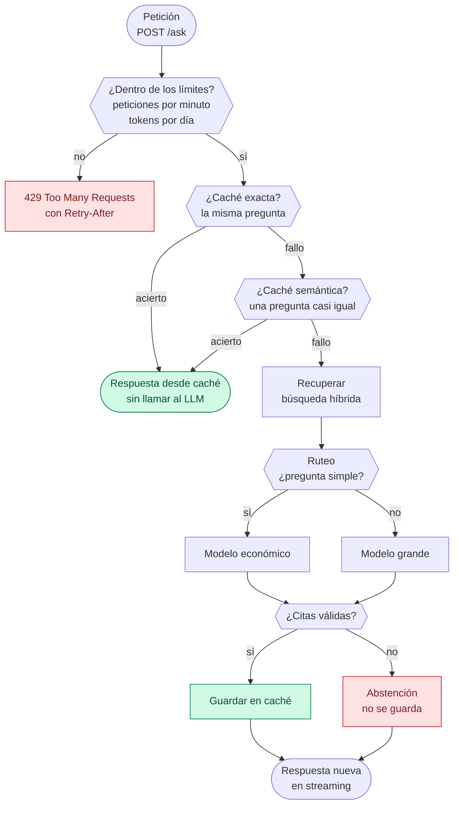
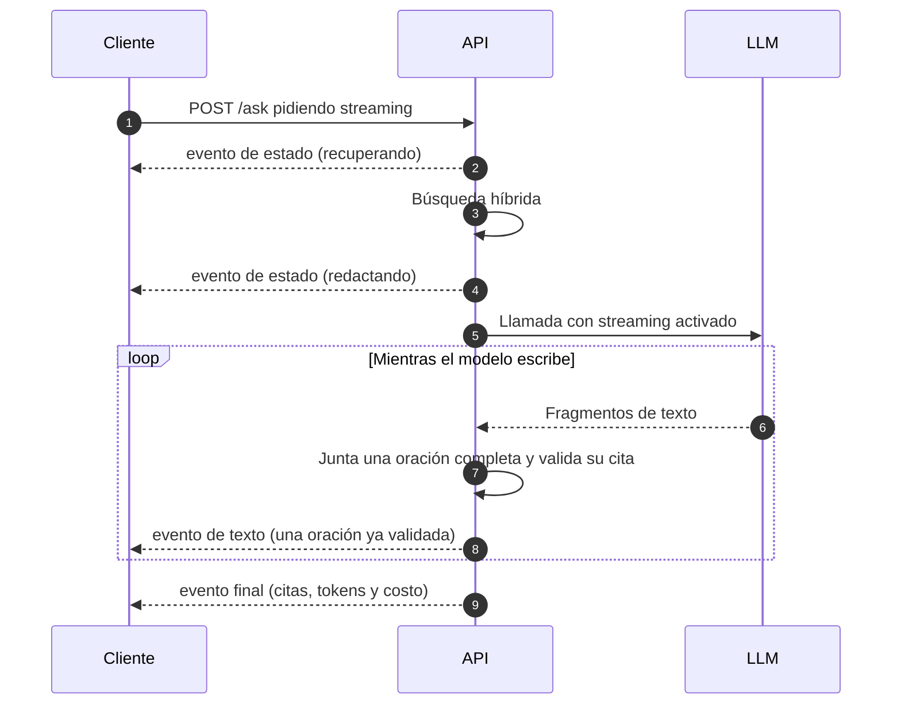
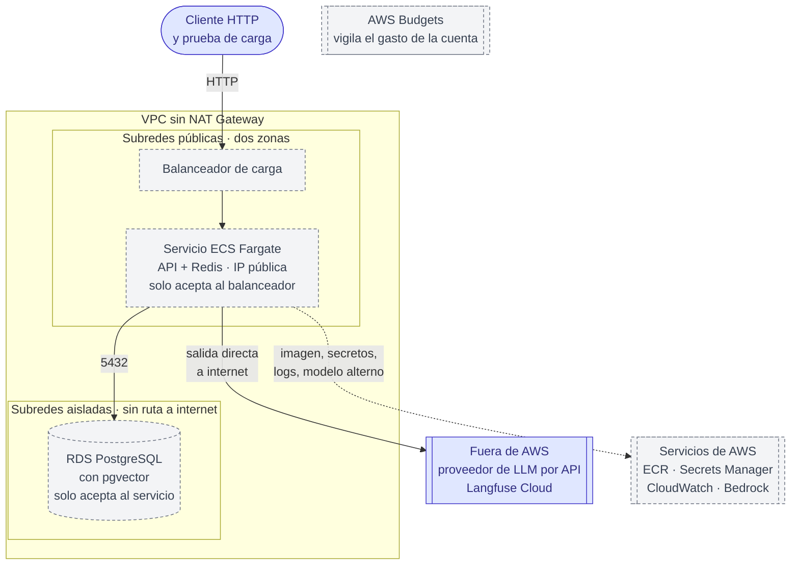

# 09 · Producción y AWS

> **Estado:** preliminar · costo y latencia se cierran en la semana 7 y el despliegue en la semana 8 ·
> **Lectura:** 10 min · [Índice](README.md) · Anterior: [08 · Evals y observabilidad](08-evals-y-observabilidad.md) · Siguiente: [10 · Decisiones](10-decisiones.md)

La v3 no agrega capacidades. Responde dos preguntas de operación: **cuánto cuesta y cuánto tarda
cada pregunta**, y **cómo se despliega sin sorpresas en la factura de la nube**.

## Parte 1 · Costo y latencia (semana 7)

### El camino de una petición en producción

Antes de llegar al LLM, una petición pasa por tres filtros baratos. Cada uno evita gastar en el
siguiente.



Los contadores de límites y las dos cachés viven en **Redis**: son datos efímeros, con expiración.

### Tres cachés distintas

| Caché | Qué guarda | Cuándo acierta | Qué ahorra | Riesgo |
|---|---|---|---|---|
| **Exacta** | La respuesta final ya validada | La pregunta normalizada es idéntica | Todo: la recuperación y el LLM | Casi ninguno, si la llave está bien armada |
| **Semántica** | La respuesta final ya validada | El embedding de la pregunta es muy parecido al de una anterior | La llamada al LLM; el embedding de la pregunta sí se calcula | Entregar la respuesta de otra pregunta |
| **De prompt, en el proveedor** | El inicio del prompt ya procesado | El inicio del prompt es idéntico al de una llamada reciente | Parte del costo y de la latencia de los tokens de entrada | Ninguno de calidad; las reglas cambian con cada proveedor |

**La llave lo es todo.** Una respuesta solo se puede reutilizar si nada de lo que la produjo cambió:

```
llave = hash(pregunta normalizada + filtros + versión del corpus + versión del prompt + modelo)
```

- *Normalizar* es pasar a minúsculas, quitar acentos y colapsar espacios.
- Si se vuelve a indexar el corpus o se cambia el prompt, la versión cambia y las entradas viejas
  dejan de coincidir solas. No hay que acordarse de borrar nada.
- Solo se guardan respuestas que pasaron la validación de citas.
- Lo que depende de los datos de un RFC (las respuestas del agente con SQL) **no se guarda**.

**El riesgo de la caché semántica**, con un ejemplo del dominio:

| Pregunta | Respuesta correcta |
|---|---|
| ¿Qué significa el uso de CFDI **G01**? | Adquisición de mercancías |
| ¿Qué significa el uso de CFDI **G03**? | Gastos en general |

Las dos preguntas difieren en un carácter y sus embeddings quedan casi pegados. Una caché semántica
con umbral flojo contesta la segunda con la respuesta de la primera. Por eso el umbral se fija alto
y se mide con pares de preguntas parecidas pero distintas, sacados del golden set.

### Ruteo de modelos

No toda pregunta necesita el modelo más caro.

| Ruta | Para qué | Señal tentativa |
|---|---|---|
| Modelo económico | Definiciones y consultas de un solo dato | Pregunta corta; la respuesta está en un solo chunk |
| Modelo grande | Comparaciones, casos con varias condiciones, el agente | Pregunta larga o con varias fuentes necesarias |

La regla para aceptar el ruteo es la misma que para cualquier cambio: el golden set se corre **por
ruta**. Si el modelo económico no sostiene los umbrales en las preguntas que le tocan, el ruteo no
entra, por mucho que ahorre.

### Límites de uso

| Límite | Qué cuenta | Dónde se revisa | Al excederlo |
|---|---|---|---|
| Peticiones por minuto | Llamadas por llave de API | Contador en Redis con expiración | 429 con `Retry-After` |
| Presupuesto de tokens por día | Tokens de entrada y de salida por llave | Contador en Redis | 429 hasta el día siguiente |
| Tamaño de entrada | Caracteres del texto o la pregunta | Pydantic, antes de llamar al LLM | 422 |
| Tamaño de salida | Tokens máximos de la respuesta | Parámetro de la llamada al LLM | La respuesta se corta |
| Pasos del agente | Llamadas a tools por conversación | Estado del grafo | El agente se detiene y lo dice |

Es la defensa contra el riesgo **LLM10 · Unbounded Consumption** del
[documento 06](06-agente-mcp-y-seguridad.md#seguridad).

### Streaming

El streaming no reduce el tiempo total: reduce el tiempo **hasta ver algo**. Se transmite por
*Server-Sent Events* (SSE), una respuesta HTTP que se queda abierta y manda eventos de texto.



Aquí hay una tensión de diseño: el sistema promete **validar antes de responder**, y el streaming
quiere **responder antes de terminar**.

| Opción | Qué ve el usuario | Problema |
|---|---|---|
| Transmitir cada token | Texto inmediato | Se muestra texto que todavía no se validó |
| Esperar y mandar todo al final | Nada, hasta que termina | No mejora la latencia percibida |
| **Eventos de estado + oraciones ya validadas** (tentativa) | Actividad inmediata y texto por bloques | Más lógica en el servidor |

Se miden dos latencias por separado: **tiempo al primer evento** y **tiempo total**.

### Cómo se mide

```
costo por 1,000 preguntas = 1,000 × (1 − tasa de aciertos de caché) × costo promedio de una pregunta sin caché
```

Ejemplo con números inventados, solo para ver la cuenta: con 30 % de aciertos y 0.002 USD por
pregunta sin caché, `1,000 × 0.70 × 0.002 = 1.40 USD`.

- El costo del LLM sale de las trazas de Langfuse (tokens × precio).
- El costo de infraestructura se cuenta aparte: horas encendido × precio por hora de cada recurso.
- La prueba de carga reporta p50, p95, errores y tasa de aciertos, **con y sin caché**.

## Parte 2 · Despliegue en AWS (semana 8)

El objetivo no es dejar un servicio prendido. Es desplegarlo con infraestructura como código (CDK),
medir un día de costo real y **destruirlo el mismo día**.

### El mapa



### Qué hace cada recurso

| Recurso | Para qué | El detalle que importa |
|---|---|---|
| **Balanceador (ALB)** | Punto de entrada y revisión de salud en `GET /health` | Corta conexiones sin datos durante 60 s (valor por omisión): afecta al streaming |
| **ECS Fargate** | Corre el contenedor sin administrar servidores | La tarea tiene IP pública, pero su *security group* solo acepta al balanceador |
| **RDS PostgreSQL** | La misma base que en desarrollo, con pgvector | Subredes aisladas; solo acepta al servicio; se crea con política de borrado "destruir" |
| **ECR** | Guarda la imagen del contenedor | La arquitectura de la imagen debe coincidir con la de la tarea |
| **Secrets Manager** | Llaves de API y contraseña de la base | Se inyectan al arrancar la tarea; nunca van en la imagen ni en el repositorio |
| **CloudWatch** | Logs del contenedor y alarmas | Retención corta, y el grupo de logs se borra con el stack |
| **Bedrock** | Un segundo proveedor de LLM, dentro de AWS | La API Converse usa la misma forma de llamada para varios modelos; hay que confirmar el acceso al modelo en la región |
| **AWS Budgets** | Avisa cuando el gasto pasa de un monto | La alerta avisa, no apaga; y sus datos llegan con horas de retraso |

### Por qué sin NAT Gateway

El contenedor necesita salir a internet: para bajar su imagen, leer secretos y llamar al LLM. Hay
tres formas de dárselo:

| Opción | Cómo sale el contenedor | Costo fijo | Qué se pierde |
|---|---|---|---|
| **Subred pública + IP pública** (elegida) | Directo, por el *Internet Gateway* | Solo la IP pública | La tarea tiene IP pública; la protege su *security group* |
| Subred privada + NAT Gateway | A través del NAT | Por hora y por GB, haya tráfico o no | Nada técnico: es el diseño de libro, y el más caro para una prueba de un día |
| Subred privada + *VPC endpoints* | No sale: solo alcanza servicios de AWS | Por hora, por cada endpoint y por cada zona | No puede llamar a un LLM fuera de AWS ni a Langfuse Cloud |

Como referencia, un NAT Gateway en `us-east-1` ronda 0.045 USD por hora más 0.045 USD por GB, unos
33 USD al mes sin tráfico, y cada dirección IPv4 pública cuesta 0.005 USD por hora. Los precios se
revisan el día del despliegue; lo que no cambia es la forma del cobro.

La base de datos no cambia en ninguna de las tres: siempre vive en subredes aisladas.

### Lo que este diseño obliga

1. **La base no se alcanza desde la laptop.** Las migraciones y la ingesta del corpus corren como
   tareas de ECS: la misma imagen con otro comando.
2. **La imagen y la tarea deben ser de la misma arquitectura.** Una Mac con Apple Silicon construye
   imágenes `arm64`. Si la tarea espera `x86_64`, el contenedor muere al arrancar con
   `exec format error`.
3. **`GET /health` no llama al LLM.** Si lo hiciera, una caída del proveedor tumbaría el servicio
   completo, y cada revisión de salud costaría dinero.
4. **El streaming necesita un latido.** Un evento vacío cada 15 segundos evita que el balanceador
   cierre la conexión mientras el modelo piensa.
5. **Redis junto a la API solo sirve con una tarea.** Con dos tareas, cada una tendría sus propios
   contadores y su propia caché. En ese momento Redis se muda a un servicio administrado.

### El día del despliegue

| Paso | Qué se hace | Para qué |
|---|---|---|
| 1 | Crear el presupuesto con alerta | Enterarse si algo se queda prendido |
| 2 | `cdk deploy` | Levantar red, base, servicio y balanceador |
| 3 | Migraciones e ingesta, como tareas | Crear las tablas y cargar el corpus desde dentro de la VPC |
| 4 | Prueba de humo: `GET /health` y una pregunta del golden set | Confirmar que todo el camino funciona antes de medir |
| 5 | Prueba de carga | Obtener p50, p95, errores y costo por 1,000 preguntas |
| 6 | Anotar los números en el README | Que el resultado sobreviva al stack |
| 7 | `cdk destroy` | Dejar de pagar |
| 8 | Revisar que no quedó nada | Cubrir lo que `cdk destroy` no borra solo |

El trabajo se parte en dos días. El primero se escribe el stack y se revisa sin desplegar
(`cdk synth` y `cdk diff`). El segundo se despliega, se mide y se destruye.

**Lo que `cdk destroy` no borra solo**, y por eso existe el paso 8:

- Los *snapshots* de RDS. Por omisión, CDK conserva uno al borrar la instancia; hay que pedirle
  explícitamente que la destruya.
- Los grupos de logs que se crearon con política de conservar.
- Las imágenes subidas al repositorio de *bootstrap* de CDK, que vive fuera del stack.

### Decisiones abiertas

Se cierran en las semanas 7 y 8:

- Umbral de la caché semántica, y si las abstenciones también se guardan (con expiración corta).
- La señal del ruteo: una regla simple o un clasificador.
- HTTP o HTTPS en la prueba. HTTPS exige un dominio y un certificado; para un día con datos
  sintéticos puede bastar HTTP, y es lo primero que cambia si el servicio deja de ser efímero.
- Qué modelo de Bedrock se usa como alterno.
- Región y tamaño de la tarea y de la instancia.

### Referencias

- [Atributos del Application Load Balancer](https://docs.aws.amazon.com/elasticloadbalancing/latest/application/edit-load-balancer-attributes.html): tiempo de inactividad.
- [Buenas prácticas de AWS Budgets](https://docs.aws.amazon.com/cost-management/latest/userguide/budgets-best-practices.html): frecuencia de actualización.
- [`RemovalPolicy` en CDK](https://docs.aws.amazon.com/cdk/api/v2/docs/aws-cdk-lib.RemovalPolicy.html): qué pasa con un recurso al borrar el stack.
- [pgvector 0.8.0 en RDS for PostgreSQL](https://aws.amazon.com/about-aws/whats-new/2024/11/amazon-rds-for-postgresql-pgvector-080): versiones del motor que lo incluyen.

## Comprueba que lo entendiste

<details>
<summary>1. ¿Por qué la llave de la caché incluye la versión del corpus y la del prompt?</summary>

Porque una respuesta solo es reutilizable si nada de lo que la produjo cambió. Si se vuelve a
indexar el corpus o se cambia el prompt y la llave no lo refleja, el sistema seguiría entregando
respuestas viejas. Con la versión en la llave, las entradas anteriores simplemente dejan de coincidir.
</details>

<details>
<summary>2. ¿Qué riesgo tiene la caché semántica que no tiene la exacta?</summary>

Entregar la respuesta de otra pregunta. Dos preguntas pueden diferir en un detalle que lo cambia
todo (G01 contra G03) y aun así tener embeddings casi iguales. Por eso el umbral se fija alto y se
mide con pares de preguntas parecidas pero distintas.
</details>

<details>
<summary>3. ¿Por qué una alerta de AWS Budgets no basta para proteger el gasto?</summary>

Porque avisa pero no apaga nada, y sus datos llegan con horas de retraso: cuando el correo sale, el
gasto ya ocurrió. La protección real es destruir el stack el mismo día y revisar que no quedaron
recursos vivos.
</details>
