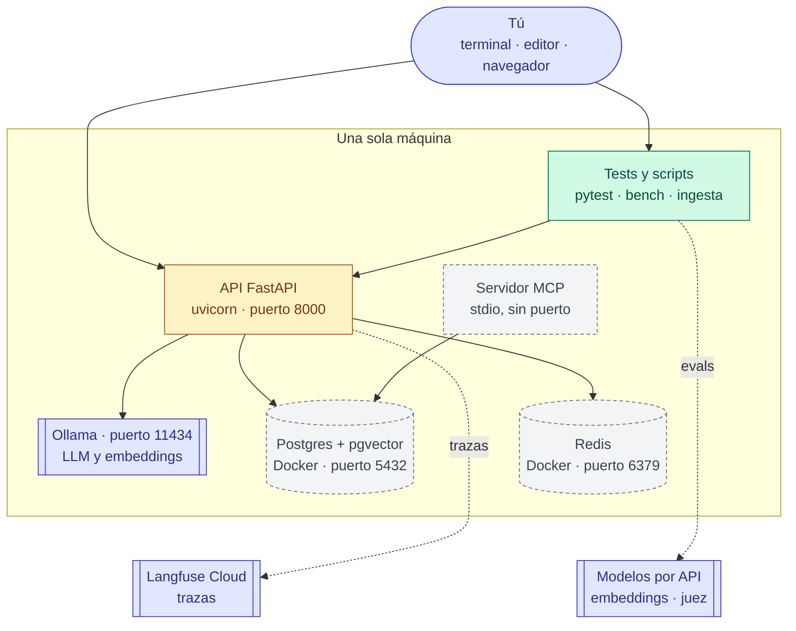
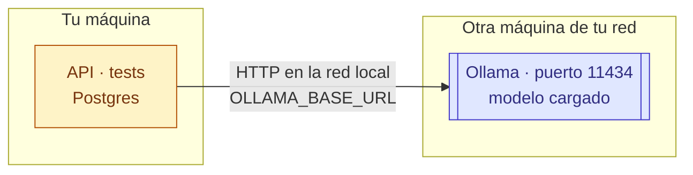

# 11 · Entorno local

> **Estado:** detallado para la semana 1; las piezas de semanas futuras son preliminares y sus números se cierran al medirlas ·
> **Lectura:** 5 min · [Índice](README.md) · Anterior: [10 · Decisiones](10-decisiones.md) · Siguiente: [Glosario](glosario.md)

Qué corre en tu máquina, cuánta memoria pide y qué queda fuera de ella.

## La respuesta corta

- **Todo corre en una sola máquina hasta la semana 7.** Programar, probar y medir no requiere
  desplegar nada.
- **El único despliegue es el de la semana 8**, en AWS, y se destruye el mismo día. Está en el
  [documento 09](09-produccion-y-aws.md).
- **Los tests no necesitan nada levantado.** El LLM se simula con `httpx.MockTransport`, así que
  `uv run pytest` corre sin Ollama, sin base de datos y sin red.
- Antes de la semana 8, lo único que vive fuera de tu máquina son **servicios de terceros que se
  usan con una llave de API**. No son despliegues tuyos y están listados
  [al final](#lo-que-no-corre-en-tu-máquina).

## El mapa

Los colores son los de [siempre](README.md): verde existe, amarillo está en construcción, gris
punteado está diseñado y azul no es código de este repo. Ollama va en azul aunque corra en tu
máquina, porque es un programa aparte. Lo que queda fuera del recuadro es lo único que necesita
internet.

## Qué corre y desde cuándo

| Pieza | Cómo se levanta | Puerto | Llega en | Memoria aproximada |
|---|---|---|---|---|
| Tests | `uv run pytest` | — | ya existe | despreciable |
| API | `uv run uvicorn cfdi_copilot.api:app --reload` | 8000 | semana 1 | decenas de MB |
| Ollama con `qwen2.5:7b` | la app de Ollama u `ollama serve`, y una vez `ollama pull qwen2.5:7b` | 11434 | semana 1 | 5 a 6 GB con el modelo cargado; el archivo pesa unos 4.7 GB |
| Embeddings `bge-m3` en Ollama | `ollama pull bge-m3` | 11434 | semana 2 | 1 a 2 GB; el archivo pesa unos 1.2 GB |
| Postgres + pgvector | contenedor de Docker | 5432 | semana 1 (facturas) · semana 2 (RAG) | cientos de MB |
| Servidor MCP | lo arranca su cliente como proceso hijo | — | semana 1 (versión mínima) · semana 5 | decenas de MB |
| Reranker local, opcional | dentro del proceso de Python | — | semana 4 | 2 a 3 GB |
| Redis | contenedor de Docker | 6379 | semana 7 | decenas de MB |

Tres cosas que explican la tabla:

- **Ollama sirve el LLM y los embeddings por el mismo puerto.** Carga cada modelo en memoria la
  primera vez que se usa y lo descarga tras unos minutos sin uso (5 por omisión). `ollama list`
  dice cuánto pesa cada modelo en disco.
- **El servidor MCP no escucha en ningún puerto.** Con el transporte stdio, su cliente (el agente
  o Claude Desktop) lo arranca como proceso hijo y le habla por la entrada y la salida estándar.
- **Postgres y Redis van en contenedores** para no instalar nada en el sistema y para que la
  versión de pgvector sea la misma en todos lados.

## ¿Alcanza mi máquina?

Lo que más pesa es el modelo local. Lo demás cabe en cualquier laptop reciente.

| Momento | Qué está cargado a la vez | Memoria del proyecto (estimada) |
|---|---|---|
| Semana 1 | API + `qwen2.5:7b` | unos 6 GB |
| Semanas 2 y 3 | lo anterior + Postgres + `bge-m3` | unos 8 GB |
| Semana 4, con reranker local | lo anterior + reranker | 10 a 11 GB |

A eso se suma lo que ya ocupa tu sistema con el editor y el navegador abiertos. Como regla
práctica, **con 16 GB o más todo cabe en una máquina**; con 8 GB, el modelo de 7B ya no convive
con lo demás. Son estimaciones: se reemplazan por lo medido cada semana.

No hace falta adivinar. Dos mediciones lo dicen:

| Medición | Comando | Señal de que no alcanza |
|---|---|---|
| Dónde quedó el modelo | `ollama ps`, justo después de una llamada | La columna `PROCESSOR` no dice `100% GPU`: parte del modelo quedó en CPU |
| Cuánto tarda una factura | `uv run python scripts/s1_extract_bench.py --n 20` | Un p50 de decenas de segundos, o respuestas 504: el cliente corta la lectura a los 60 segundos (`DEFAULT_TIMEOUT` en `llm.py`) |

### Si no alcanza, en este orden

1. **Libera memoria y repite.** Cierra lo que compite (pestañas, contenedores sin usar) y vuelve a
   medir.
2. **Usa un modelo más chico para desarrollar**, por ejemplo `OLLAMA_MODEL=llama3.2:3b`, que pesa
   unos 2 GB. Extrae peor, y no importa: lo local solo sirve para desarrollar
   ([D8](10-decisiones.md#llm-y-extracción)).
3. **Mueve solo el LLM a otra máquina de tu red**, como se explica en la siguiente sección.
4. **Desarrolla contra un modelo por API.** Cuesta centavos y quita toda la carga local; a cambio,
   cada prueba depende de la red y de una llave. Se puede desde que exista el adaptador del segundo
   proveedor, en la semana 3.

## Otra máquina como servidor de Ollama (opcional)

Cada servicio se alcanza por una URL que entra por variable de entorno. Por eso mover el LLM a otra
máquina no toca el código: cambia `OLLAMA_BASE_URL`.

| Paso | Dónde | Qué se hace |
|---|---|---|
| 1 | la otra máquina | Instalar Ollama y bajar el modelo: `ollama pull qwen2.5:7b` |
| 2 | la otra máquina | Hacer que escuche en la red y no solo en `localhost`: definir `OLLAMA_HOST=0.0.0.0:11434` y reiniciar Ollama |
| 3 | la otra máquina | Permitir el puerto 11434 en su firewall, solo para la red local |
| 4 | tu máquina | `export OLLAMA_BASE_URL=http://IP_DE_LA_OTRA:11434` |
| 5 | tu máquina | Comprobar con `curl $OLLAMA_BASE_URL/api/tags` y repetir el bench |

**Cuándo conviene.** Cuando la otra máquina tiene una GPU con 8 GB de memoria de video o más, o
bastante más memoria libre que la tuya. Si no, no ganas velocidad y agregas una pieza que puede
fallar. La forma de decidirlo es correr el mismo bench contra las dos y comparar el p50.

**Qué cuesta.**

- Dos máquinas prendidas y una red en medio. Aparece un modo de falla nuevo, el LLM que no
  responde, que el [flujo de `/extract`](04-flujo-extract.md) ya traduce a 502 y 504.
- **Ollama no pide contraseña.** Cualquiera que alcance ese puerto puede usarlo, así que se abre a
  la red de casa y nunca a internet.
- Lo demás no se mueve: la API, los tests y Postgres siguen en tu máquina.

## Comprobar que todo está arriba

| Qué | Comando | Qué debes ver |
|---|---|---|
| Código y tests | `uv run pytest` | Verde, salvo los tests de una pieza que todavía tenga `TODO` |
| Ollama responde | `curl http://localhost:11434/api/tags` | Un JSON con los modelos descargados |
| El modelo cupo en memoria | `ollama ps` | `100% GPU` en la columna `PROCESSOR`; en una máquina sin GPU dirá `100% CPU` y será lento |
| La API levanta | `uv run uvicorn cfdi_copilot.api:app --reload` | `http://localhost:8000/docs` muestra los endpoints |
| Latencia real | `uv run python scripts/s1_extract_bench.py --n 20` | `results/s1_extract.json` con p50 y p95 |

## Lo que no corre en tu máquina

| Servicio | Para qué | Desde | Costo | Qué necesitas |
|---|---|---|---|---|
| Langfuse Cloud | Trazas, costo por llamada y versiones de prompt | semana 1 | plan gratuito | una cuenta y sus llaves |
| API de embeddings | Comparar `text-embedding-3-small` contra `bge-m3` | semana 2 | centavos | una llave de API |
| LLM por API como juez | Calificar los evals; un modelo local no sirve de juez | semana 3 | centavos por corrida | una llave de API |
| GitHub Actions | Correr tests y evals en cada cambio | semana 3 | gratis en repositorios públicos | nada: viene con el repositorio |
| Reranker por API, opcional | Alternativa al reranker local | semana 4 | centavos | una llave de API |
| AWS | El despliegue de la semana 8 | semana 8 | dólares, medidos ese día | una cuenta y un presupuesto con alerta |

Solo la última fila es un despliegue. Las demás son servicios de terceros que se usan con una llave;
las llaves entran por variables de entorno y nunca se suben al repositorio
([Configuración y secretos](03-arquitectura.md#configuración-y-secretos)).

La decisión de fondo está registrada como **D32** en el [documento 10](10-decisiones.md#operación).

## Comprueba que lo entendiste

1. ¿Por qué los tests pasan sin Ollama y sin base de datos?

Porque cada caso de uso recibe sus dependencias en lugar de crearlas. El test le pasa un cliente
falso (`httpx.MockTransport`) que contesta lo que el test necesita, así que nunca se abre una
conexión real. Por eso los tests son rápidos, deterministas y corren igual en el CI.

2. <code>ollama ps</code> muestra el modelo repartido entre CPU y GPU y cada factura tarda más de un minuto. ¿Qué pruebas, y en qué orden?

Primero liberar memoria y medir otra vez. Si no basta, un modelo más chico para desarrollar. Después,
mover solo el LLM a otra máquina de la red cambiando `OLLAMA_BASE_URL`. Y como última opción, un
modelo por API. El orden va de lo que no cuesta nada a lo que agrega piezas o dinero.

3. ¿Por qué el Ollama de la otra máquina se abre solo a la red local?

Porque Ollama no tiene autenticación: quien alcance el puerto 11434 puede usar el modelo y ocupar
esa máquina. En la red de casa el riesgo es bajo; en internet, cualquiera lo encontraría.

