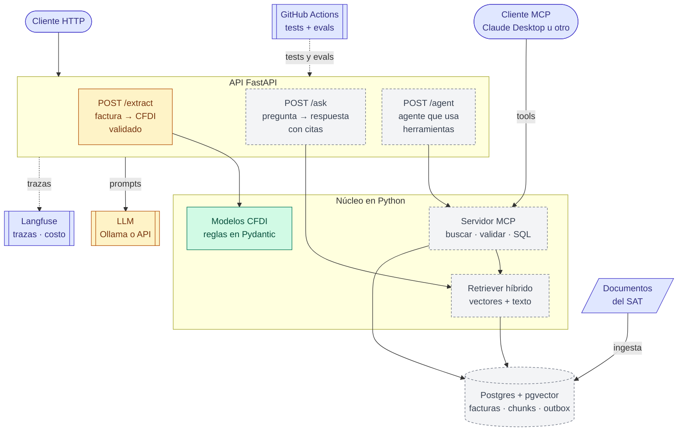

# Diseño de cfdi-copilot

Esta carpeta explica **cómo funciona el sistema antes de programarlo**: qué piezas tiene, qué hace
cada una y cómo viaja la información entre ellas. El orden de trabajo del proyecto es siempre el
mismo: primero se entiende y se dibuja aquí, después se programa y al final se mide.

## El sistema en una página

**Cómo leer los colores** (se usan igual en todos los documentos): verde = ya existe en el repo ·
amarillo = en construcción · gris punteado = diseñado, todavía sin código · azul = actor o servicio
externo. En los diagramas de flujo, verde y rojo marcan además el resultado: salió bien o salió mal.

En una frase: cfdi-copilot recibe **facturas** y **preguntas** sobre CFDI 4.0, usa un LLM para
extraer o redactar, y **nunca le cree al LLM sin verificar**. Lo que extrae se valida con reglas de
negocio; lo que responde tiene que citar un documento oficial del SAT o decir "no lo sé".

## Las cuatro capacidades

| Capacidad | Entrada → salida | Cómo se verifica | Llega en |
|---|---|---|---|
| **Extraer** · `POST /extract` | texto de una factura → `Comprobante` validado | reglas de negocio en Pydantic | semana 1 |
| **Preguntar** · `POST /ask` | pregunta → respuesta con citas | cada afirmación cita su fuente; sin evidencia responde "no lo sé" | v0 · semana 2 |
| **Medir** · evals en CI | un cambio de código → pasa o no pasa | golden set de preguntas con umbrales | v1 · semanas 3 y 4 |
| **Actuar** · `POST /agent` + MCP | tarea compuesta → pasos con herramientas | permisos mínimos, límites y aprobación humana | v2 · semanas 5 y 6 |

La v3 (semanas 7 y 8) no agrega capacidades. Agrega operación: costo por pregunta, latencia y
despliegue en AWS.

## Qué existe hoy

| Pieza | Dónde vive | Estado |
|---|---|---|
| Modelos del dominio: `Comprobante`, `Emisor`, `Receptor`, `Concepto` | `src/cfdi_copilot/models.py` | Hecho y probado |
| Generador de facturas sintéticas | `src/cfdi_copilot/synthetic.py` | Hecho |
| Cliente async del LLM: `OllamaClient` | `src/cfdi_copilot/llm.py` | Hecho; falta mandar el JSON Schema (structured outputs) |
| Endpoint `POST /extract` | `src/cfdi_copilot/api.py` y `extract.py` | Esqueleto con `TODO`; 6 tests esperando en `tests/test_api.py` |
| RAG, evals, agente, MCP, seguridad, AWS | (sin código) | Diseñado en esta carpeta |

Los 60 tests de modelos y cliente pasan sin LLM ni base de datos (`uv run pytest`).

## Orden de lectura

| # | Documento | La pregunta que responde | Minutos | Léelo antes de… |
|---|---|---|---|---|
| 1 | Este README | ¿Qué es el sistema y qué piezas tiene? | 5 | todo |
| 2 | [01 · Visión y alcance](01-vision-y-alcance.md) | ¿Qué problema resuelve y qué no hace? | 5 | todo |
| 3 | [02 · Dominio CFDI](02-dominio-cfdi.md) | ¿Qué es un CFDI y qué parte modelamos? | 10 | tocar `models.py` |
| 4 | [03 · Arquitectura](03-arquitectura.md) | ¿Qué componentes hay y quién habla con quién? | 10 | programar cualquier módulo |
| 5 | [04 · Flujo de `/extract`](04-flujo-extract.md) | ¿Qué pasa, paso a paso, al extraer una factura? | 15 | la semana 1 |
| 6 | [08 · Evals y observabilidad](08-evals-y-observabilidad.md) | ¿Cómo sabemos qué pasó y qué tan bueno es? | 10 | conectar Langfuse (semana 1) y la semana 3 |
| 7 | [07 · Modelo de datos](07-modelo-de-datos.md) | ¿Qué tablas hay y qué garantiza cada transacción? | 10 | el cierre de la semana 1 |
| 8 | [05 · Flujos de RAG](05-flujos-rag.md) | ¿Cómo se indexan los documentos y cómo se responde con citas? | 15 | la semana 2 |
| 9 | [06 · Agente, MCP y seguridad](06-agente-mcp-y-seguridad.md) | ¿Cuándo decide el LLM y cómo se le ponen límites? | 15 | la semana 5 |
| 10 | [09 · Producción y AWS](09-produccion-y-aws.md) | ¿Cómo se controla costo y latencia y cómo se despliega? | 10 | la semana 7 |
| — | [10 · Decisiones](10-decisiones.md) | ¿Por qué se eligió cada cosa y qué se sacrificó? | consulta | defender el diseño |
| — | [Glosario](glosario.md) | ¿Qué significa este término? | consulta | — |

Los documentos 1 a 5 bastan para programar la semana 1 entendiendo dónde cae cada pieza.

## Cómo se mantiene esta carpeta

1. **Diseño.** Antes de programar una pieza se lee su flujo aquí. Si el flujo no existe o ya no
   convence, se corrige primero el documento.
2. **Código.** Se programa contra el diagrama. Cada `TODO` del código apunta a un paso del flujo.
3. **Medición.** Lo medido (latencia, porcentaje válido, recall) se anota en el documento y, si
   contradice el diseño, el diseño cambia.

Cada documento declara su estado en la primera línea:

- **Detallado**: describe código que existe o que se programa esta semana. Debe coincidir con el repo.
- **Preliminar**: diseño a nivel de flujo para semanas futuras. Los nombres de módulos, tablas y
  parámetros son tentativos y se cierran la semana que toca, con números.

## Convenciones

- Los diagramas están en [Mermaid](https://mermaid.js.org/): GitHub los dibuja solo. En VS Code se
  ven con la extensión *Markdown Preview Mermaid Support*.
- Los nombres de campos de una factura usan los del Anexo 20 (`Rfc`, `UsoCFDI`, `SubTotal`); los
  nombres de Python van en `snake_case`. La tabla de equivalencias está en el documento 02.
- "Semana N" se refiere al plan de 8 semanas del [README principal](../../README.md).
- Al final de cada documento numerado hay tres preguntas para comprobar que se entendió, con
  respuesta oculta.
